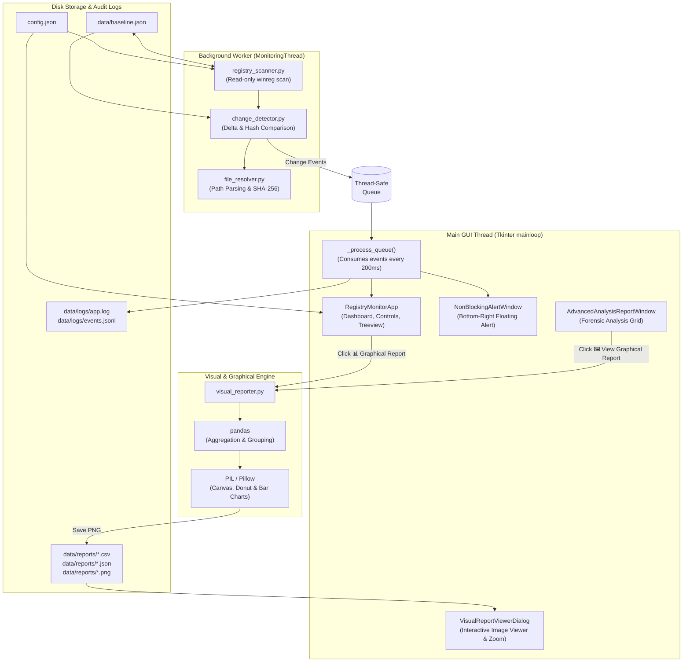
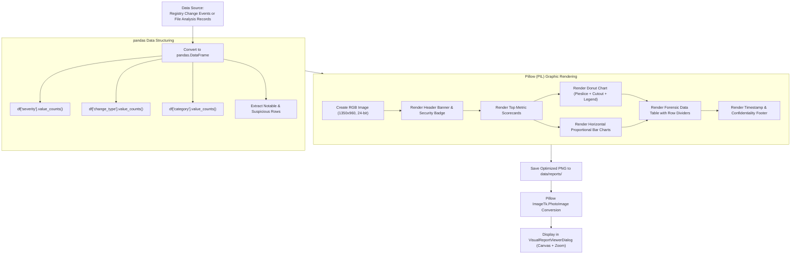
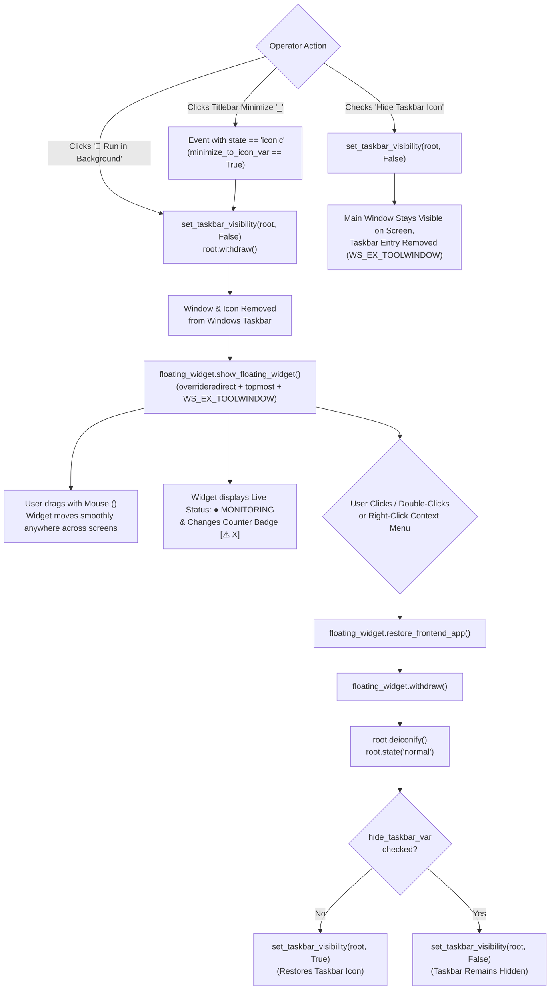
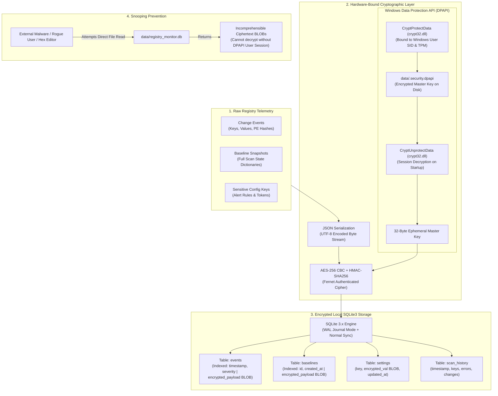
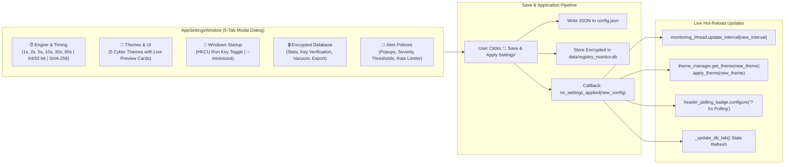

# Windows Registry Change Monitoring System — Technical Manual & Architecture Guide

A comprehensive technical reference detailing the system architecture, component responsibilities, programming language and technology stack, source code mechanics, execution workflows, flow charts, and visual reporting capabilities for the **Windows Registry Change Monitoring System**.

---

## Table of Contents

1. [Executive Summary & Purpose](#1-executive-summary--purpose)
2. [How the System Works: 6-Phase Operational Lifecycle](#2-how-the-system-works-6-phase-operational-lifecycle)
3. [What Is In It: System Features & Capabilities](#3-what-is-in-it-system-features--capabilities)
4. [Language & Technology Stack (Python, PIL, Pandas)](#4-language--technology-stack-python-pil-pandas)
5. [Project File Structure](#5-project-file-structure)
6. [File-by-File Reference (Which File Does What)](#6-file-by-file-reference-which-file-does-what)
7. [System Flow Charts & Architectural Diagrams](#7-system-flow-charts--architectural-diagrams)
   - [7.1 Overall Architecture & Threading Model](#71-overall-architecture--threading-model)
   - [7.2 Continuous Monitoring & Detection Loop](#72-continuous-monitoring--detection-loop)
   - [7.3 Advanced System Monitoring & Forensic File Analysis Flow](#73-advanced-system-monitoring--forensic-file-analysis-flow)
   - [7.4 Visual & Graphical Image Report Generation Pipeline](#74-visual--graphical-image-report-generation-pipeline)
   - [7.5 Alert Manager & Notification Pipeline](#75-alert-manager--notification-pipeline)
   - [7.6 Taskbar Concealment & Desktop Floating Widget Workflow](#76-taskbar-concealment--desktop-floating-widget-workflow)
   - [7.7 Cyber Blue Team Modern Dashboard UI Architecture](#77-cyber-blue-team-modern-dashboard-ui-architecture)
   - [7.8 Local Encrypted Database Architecture (AES-256 + Windows DPAPI)](#78-local-encrypted-database-architecture-aes-256--windows-dpapi)
   - [7.9 App Settings & Dynamic Multi-Theme Engine](#79-app-settings--dynamic-multi-theme-engine)
8. [Core Source Code Deep Dive](#8-core-source-code-deep-dive)
   - [8.1 Registry Enumeration & Bitness Views](#81-registry-enumeration--bitness-views)
   - [8.2 Executable Command-Line Parsing & File Resolution](#82-executable-command-line-parsing--file-resolution)
   - [8.3 Delta Comparison & On-Disk Tampering Detection](#83-delta-comparison--on-disk-tampering-detection)
   - [8.4 Forensic Risk Assessment Heuristics](#84-forensic-risk-assessment-heuristics)
   - [8.5 Visual Reporting & Graphical Image Canvas Generation (PIL & Pandas)](#85-visual-reporting--graphical-image-canvas-generation-pil--pandas)
   - [8.6 In-GUI Visual Image Viewer with Dynamic Zooming](#86-in-gui-visual-image-viewer-with-dynamic-zooming)
   - [8.7 Win32 Extended Window Styles (WS_EX_TOOLWINDOW) Taskbar Concealment](#87-win32-extended-window-styles-ws_ex_toolwindow-taskbar-concealment)
   - [8.8 Draggable Floating Desktop Widget & Context Menu Integration](#88-draggable-floating-desktop-widget--context-menu-integration)
   - [8.9 Console Window Background Auto-Concealment](#89-console-window-background-auto-concealment)
   - [8.10 Cyber Blue Team Dashboard & Dual-Card Forensic Telemetry Inspector](#810-cyber-blue-team-dashboard--dual-card-forensic-telemetry-inspector)
   - [8.11 Standalone Windows Executable Compilation (PyInstaller & Frozen Path Bootstrap)](#811-standalone-windows-executable-compilation-pyinstaller--frozen-path-bootstrap)
   - [8.12 Local Database Encryption & Windows DPAPI Key Protection](#812-local-database-encryption--windows-dpapi-key-protection)
   - [8.13 Windows Auto-Start via Run Registry Key](#813-windows-auto-start-via-run-registry-key)
   - [8.14 Multi-Theme Color Token System](#814-multi-theme-color-token-system)
   - [8.15 System Preferences & App Settings Dialog Implementation](#815-system-preferences--app-settings-dialog-implementation)
9. [Operational Guide: Running, Auditing & Exporting Visual Reports](#9-operational-guide-running-auditing--exporting-visual-reports)

---

## 1. Executive Summary & Purpose

The **Windows Registry Change Monitoring System** is a defensive, read-only Windows security auditing application engineered for cybersecurity blue teams, incident responders, forensic investigators, and system administrators. It audits critical registry locations to detect unauthorized persistence mechanisms, security configuration tampering, and path hijacking in real time.

### Core Defensive Principles
- **Strictly Read-Only**: The tool never creates, alters, or deletes any registry keys or values.
- **Zero Binary Execution**: The tool parses, inspects, and hashes files referenced by the registry, but **never executes, launches, quarantines, or modifies** any binary on disk.
- **Robust Dependency Architecture**: Standard library core for registry access and monitoring, coupled with production-grade data processing and visualization via **`Pillow` (`PIL`)** and **`pandas`**.
- **Preservation of Access Denials**: Protected system keys that return access errors are explicitly preserved as `access_denied` status records. They are never falsely flagged as deleted.
- **Bitness-Aware Auditing**: Evaluates both native 64-bit registry keys and 32-bit redirected keys (`WOW6432Node`) simultaneously.
- **Visual Intelligence**: Generates publication-ready graphical infographics and provides an interactive in-GUI visual report viewer.

---

## 2. How the System Works: 6-Phase Operational Lifecycle

```
┌────────────────────┐     ┌─────────────────────┐     ┌──────────────────────┐
│  Phase 1: Config   │ ──> │   Phase 2: Baseline │ ──> │  Phase 3: Continuous │
│  & Environment     │     │   Capture & Storage │     │  Polling Monitoring  │
└────────────────────┘     └─────────────────────┘     └──────────────────────┘
                                                                   │
                                                                   ▼
┌────────────────────┐     ┌─────────────────────┐     ┌──────────────────────┐
│  Phase 6: Visual   │ <── │  Phase 5: Forensic  │ <── │  Phase 4: Alerting   │
│  Graphical Reports │     │  Advanced Analysis  │     │  & Event Logging     │
└────────────────────┘     └─────────────────────┘     └──────────────────────┘
```

### Phase 1: Environment & Configuration
1. The application verifies it is running on **Windows** (`sys.platform == 'win32'`).
2. Loads configuration from `config.json` (or falls back to safe defaults).
3. Initializes logging with a rotating file handler at `data/logs/app.log` and an event stream at `data/logs/events.jsonl`.

### Phase 2: Selected-Path Baseline Capture
1. Rather than scanning the entire registry (which contains millions of entries and could cause system instability), it targets **configured security-critical subkeys**.
2. Iterates over startup persistence hives (Run/RunOnce in HKCU, HKLM, WOW6432Node), Windows Defender policy paths, Windows Firewall profiles, LSA security policies, and critical services.
3. Captures key path, value name, value data, and registry data type (`REG_SZ`, `REG_DWORD`, `REG_BINARY`, etc.).
4. Computes a SHA-256 integrity hash of the baseline snapshot and saves it atomically to `data/baseline.json`.

### Phase 3: Continuous Polling Monitoring
1. Spawns a background `MonitoringThread` (daemon) that sleeps for a configurable interval (default: 5 seconds).
2. Performs a read-only rescan of the monitored paths.
3. Passes the new snapshot against the previous known state to `change_detector.py`.
4. Emits structured event dictionaries over a thread-safe `queue.Queue`.

### Phase 4: Change Detection, Resolution & Alerting
1. Emits event types: `ADDED`, `MODIFIED`, `DELETED`, `TYPE_CHANGED`, `ERROR`, `FILE_MODIFIED`, or `FILE_DELETED`.
2. For string entries (`REG_SZ`, `REG_EXPAND_SZ`), `file_resolver.py` parses out the executable binary, expands environment variables (`%SystemRoot%`, `%APPDATA%`), extracts command arguments, checks file existence, and calculates the SHA-256 hash.
3. Events are evaluated for severity (`informational`, `suspicious`, `investigation_required`).
4. GUI consumes events via `root.after()`.
5. Non-blocking floating desktop alert cards notify the operator without interrupting background polling or freezing the UI.

### Phase 5: Advanced Forensic Analysis
1. Operators can trigger **🛡️ Advanced System Monitoring** at any time.
2. Ingests all monitored registry entries, resolves all binaries, scripts, and libraries, assesses path hijacking and malware risks (e.g., unquoted paths, temp folders, script engines), and launches an interactive filterable report with CSV and JSON exports.

### Phase 6: Visual & Graphical Image Reporting (New)
1. Operators can click **📊 Graphical Report** from the main dashboard or **🖼️ View Graphical Report** from the Advanced Monitoring window.
2. `visual_reporter.py` processes event or file datasets through **`pandas`** for aggregation and cross-tabulation.
3. **`Pillow` (`PIL`)** generates a high-resolution (1350x960+) publication-quality PNG infographic featuring:
   - Modern cybersecurity dark/light branding and metadata headers.
   - KPI metric scorecards with colored indicator strips.
   - Anti-aliased Donut / Pie charts with legend breakdowns and percentages.
   - Multi-colored horizontal bar charts.
   - Structured triage data tables of top notable findings.
4. Auto-saves images to `data/reports/*.png` and displays them directly inside the interactive **`VisualReportViewerDialog`** in Tkinter with dynamic zoom controls.

---

## 3. What Is In It: System Features & Capabilities

| Capability | Technical Implementation | Security Value |
|:---|:---|:---|
| **Startup / Persistence Auditing** | Monitors `Run`, `RunOnce`, and `WOW6432Node` variants in HKCU and HKLM. | Identifies persistence mechanisms used by malware and autorun utilities (MITRE ATT&CK T1547.001). |
| **Security Control Auditing** | Monitors Windows Defender, Windows Firewall, and UAC/LSA policies. | Detects unauthorized defense evasion and policy tampering (MITRE ATT&CK T1562.001). |
| **Bitness Independence** | Dual-flag queries with `KEY_WOW64_64KEY` and `KEY_WOW64_32KEY`. | Catches 32-bit malware lingering in 64-bit Windows installations. |
| **On-Disk File Tampering Detection** | Compares current binary SHA-256 against baseline SHA-256. | Detects binary replacement attacks where registry value text did not change (`FILE_MODIFIED`). |
| **Path Hijacking Inspection** | Detects unquoted executable paths containing spaces. | Catches unquoted search path vulnerabilities (MITRE ATT&CK T1574.009). |
| **Orphaned Key Detection** | Verifies on-disk presence of referenced binaries. | Discovers broken uninstall residues or deleted malware binaries (`FILE_NOT_FOUND`). |
| **Suspicious Location Flagging** | Flags executables residing in `%TEMP%`, `%APPDATA%`, or volatile paths. | Catches staging directories commonly utilized by droppers. |
| **Graphical Visual Infographics** | Generates standalone high-resolution `.png` dashboards via `Pillow` and `pandas`. | Produces executive-level visual reports for incident response debriefs and documentation. |
| **In-GUI Image Viewer** | Canvas viewer with zoom in/out, fit width, save image, and default viewer launch. | Allows instant visual inspection directly within the desktop application without third-party image viewers. |
| **Background Mode & Taskbar Concealment** | Win32 `WS_EX_TOOLWINDOW` (0x80) styling + `root.withdraw()` eliminates Windows taskbar icon. | Allows continuous monitoring in the background with zero taskbar clutter or footprint. |
| **Console Window Auto-Concealment** | Win32 `GetConsoleWindow()` + `ShowWindow(hwnd, SW_HIDE)` automatically hides the black terminal window (`python.exe`). | Guarantees the console window ALWAYS runs silently in the background and NEVER displays on the front screen. |
| **Interactive Taskbar Toggle** | "Hide Taskbar Icon" checkbox (checked by default) dynamically conceals the application from the Windows Taskbar. | Displays the full frontend GUI window on screen while leaving zero icon or button footprint on the Windows Taskbar. |
| **Minimize Button to Desktop Icon** | Intercepts `<Unmap>` when `state == 'iconic'` to automatically minimize window into movable floating desktop icon. | Gives seamless native Windows minimize experience that transitions straight into the floating desktop widget. |
| **Draggable Floating Desktop Widget** | Frameless, topmost floating badge movable anywhere using mouse drag (`<B1-Motion>`). | Click to restore frontend visual app, displays live status (MONITORING/STOPPED) and changes badge. |
| **Windows Desktop Launcher** | Desktop shortcut (`.lnk`) and `.bat` with custom shield icon (`data/app_icon.ico`). | Instant one-click launch directly from the Windows desktop. |
| **Non-Blocking UI & Alerts** | Thread-safe `Queue` + `Toplevel` floating notification cards. | Prevents alert popups from freezing the scanning thread or GUI responsiveness. |
| **Audit Logs & Multi-Format Exports** | Rotating logs, JSON Lines (`.jsonl`), CSV exports, summary JSON, and visual PNG images. | Facilitates ingestion into SIEM platforms, Excel, or automated pipelines. |

---

## 4. Language & Technology Stack (Python, PIL, Pandas)

### Core Language
- **Python 3.11+ / Python 3.14+**

### Third-Party Visual Packages
- **`Pillow` (`PIL` >= 10.0.0)**: Used for high-resolution graphics generation, custom drawing of anti-aliased donut charts, bar charts, KPI scorecards, typography rendering, and `ImageTk.PhotoImage` for displaying reports within Tkinter.
- **`pandas` (>= 2.0.0)**: Used for high-speed tabular data processing, series grouping (`value_counts()`), cross-tabulation of risk categories, and structured metric calculations.

### Standard Library Modules Used

| Module | Core Responsibility |
|:---|:---|
| `winreg` | Low-level Windows API bindings for opening and enumerating registry hives and values. |
| `tkinter` / `tkinter.ttk` | Native graphical user interface, event treeview, alert cards, and forensic dialogs. |
| `threading` | Background daemon worker thread for continuous polling without UI freezing. |
| `queue` | Thread-safe FIFO queue for decoupling the background scanner from the GUI consumer. |
| `hashlib` | SHA-256 cryptographic hashing for binary integrity and baseline change verification. |
| `json` | Parsing and serializing configurations, baselines, and structured summary reports. |
| `csv` | Exporting tabular reports compatible with Excel and SIEM analysis tools. |
| `pathlib` / `os` | File system inspection, path normalization, and environment variable expansion (`os.path.expandvars`). |
| `re` | Regular expression parsing for command lines, `rundll32` patterns, and quoted path extraction. |
| `logging` | Industrial logging with `RotatingFileHandler` (max 10MB per file with 5 backups). |
| `datetime` | High-precision ISO 8601 UTC timestamps for chronological ordering. |
| `unittest` | Complete regression test suite with 47 automated unit tests. |

---

## 5. Project File Structure

```
d:\Windows Registry Monitoring System\
│
├── dist/                                 # Executables and setup packages
│   ├── WindowsRegistryMonitor.exe        # Standalone pre-compiled Windows executable (76 MB)
│   └── installer/
│       └── WindowsRegistryMonitor_Setup_v1.0.exe  # Inno Setup 7 installer package
│
├── data/                                 # Persistent runtime storage
│   ├── app_icon.ico                      # Custom cyber shield vector application icon
│   ├── baseline.json                     # Cryptographically signed baseline snapshot
│   │
│   ├── logs/                             # Diagnostic and event logs
│   │   ├── app.log                       # Rolling diagnostic application log
│   │   └── events.jsonl                  # Streaming append-only JSONL event audit log
│   │
│   ├── registry_monitor.db               # Local encrypted SQLite3 database (AES-256 + WAL mode)
│   ├── .security.dpapi                   # Windows DPAPI machine/user-bound encrypted master key
│   │
│   └── reports/                          # Exported forensic artifacts
│       ├── events_*.csv                  # Exported registry change events (CSV)
│       ├── summary_*.json                # System summary report (JSON)
│       ├── events_visual_*.png           # Graphical image report of change events (PNG)
│       ├── advanced_file_analysis_*.csv  # System-wide file analysis report (CSV)
│       ├── advanced_file_analysis_*.json # System-wide file analysis report (JSON)
│       └── advanced_file_visual_*.png    # System-wide forensic visual report (PNG)
│
├── config.json                           # Path configurations, polling delays, alert thresholds
├── main.py                               # Main GUI application, thread coordination & viewers
├── database.py                           # Encrypted SQLite3 persistence & Windows DPAPI cipher
├── autostart.py                          # Windows Run registry key auto-start manager
├── theme_manager.py                      # 5 cyber theme palettes & dynamic styler
├── settings_window.py                    # 5-tab application settings & engine configuration dialog
├── registry_scanner.py                   # Registry reading, 32/64-bit access, baseline IO
├── change_detector.py                    # Delta comparison, severity assessment, fingerprints
├── file_resolver.py                      # Command parser, hash computation, risk evaluation
├── alert_manager.py                      # Alert deduplication, rate limiting, and queueing
├── report_generator.py                   # Log setup, JSONL streaming, CSV, JSON & PNG exports
├── visual_reporter.py                    # Graphical image generator (Pillow + Pandas)
├── installer.iss                         # Inno Setup 7 installation package compiler script
├── build_exe.py                          # Automated PyInstaller build script for standalone .exe
├── requirements.txt                      # Dependencies (Pillow, Pandas, and stdlib specs)
├── README.md                             # Master project overview & quick start guide
├── HOW_IT_WORKS.md                       # Detailed technical architecture manual (this file)
├── PRESENTATION.md                       # 16-slide PowerPoint presentation blueprint & notes
├── SECURITY_ANALYSIS.md                  # STRIDE threat model, MITRE ATT&CK & DPAPI cryptanalysis
├── FORENSIC_ANALYSIS.md                  # Forensics handbook, delta math & 5 DFIR case studies
├── USER_GUIDE.md                         # Complete operator manual & troubleshooting guide
├── ABOUT.md                              # Product vision, cyber themes & technical specs
└── tests/                                # Verification & automated test suite
    ├── test_change_detector.py           # 47 unit tests (mock data, no registry writes)
    └── test_settings_and_db.py           # 14 unit tests (database, themes, autostart, settings)
```

---

## 6. File-by-File Reference (Which File Does What)

### 1. `main.py`
- **Role**: The orchestrator and GUI presentation layer.
- **Key Classes**:
  - `RegistryMonitorApp`: The primary Tkinter application window. Manages dashboard metrics, action buttons, the event treeview, live status updates, and window lifecycle.
  - `MonitoringThread`: Background `threading.Thread` executing periodic scans at the interval defined in `config.json`.
  - `NonBlockingAlertWindow`: Dedicated floating `tk.Toplevel` notification card displayed at the bottom-right corner of the screen. Does not block the main loop.
  - `FloatingDesktopWidget`: Movable floating desktop widget that stays on screen when running in background. Hidden from Windows taskbar, draggable anywhere with mouse (`<B1-Motion>`), displays live status and change counter badge, and single/double-click restores the frontend visual app.
  - `VisualReportViewerDialog`: Interactive image inspection window featuring a scrollable canvas, dynamic zooming (+25% / -25%), fit-width calculation, image export, and direct launching into Windows default photo viewer.
  - `AdvancedAnalysisReportWindow`: Standalone forensic inspection window launched by the **🛡️ Advanced System Monitoring** button. Contains metric cards, filter presets, live search, a sortable Treeview, details pane, CSV/JSON export buttons, and **🖼️ View Graphical Report**.
- **Key Functions**:
  - `hide_console_window()`: Win32 API call (`GetConsoleWindow()` + `ShowWindow(hwnd, SW_HIDE)`) that detects if a command console (`python.exe`) was spawned and immediately conceals it into the background so no black terminal window ever shows on screen.
  - `set_taskbar_visibility(widget, show=True)`: Low-level Win32 extended style manipulator using `ctypes.windll.user32`. Applies `WS_EX_TOOLWINDOW` (0x00000080) and strips `WS_EX_APPWINDOW` (0x00040000) to conceal any window from the Windows Taskbar without destroying or closing it.
  - `_toggle_hide_taskbar()`: Dynamically switches the application's taskbar presence based on the "Hide Taskbar Icon" toggle.
  - `_on_window_unmap(event)` & `_on_minimize_to_desktop()`: Intercepts the window titlebar Minimize button (`_`) click and seamlessly transitions the app to the movable floating desktop icon.
  - `_run_in_background()`: Conceals the main window from the Windows Taskbar and summons the movable floating desktop widget.
  - `_process_queue()`: Consumes scan results and changes on the main thread via `root.after(200, ...)`.
  - `_show_visual_report()`: Generates and displays the events graphical visual report.
  - `_create_baseline()`, `_rescan_registry()`, `_reset_baseline()`: Safe interactive triggers for baseline management.

### 2. `visual_reporter.py` (New Module)
- **Role**: High-resolution graphical image and infographic generator.
- **Dependencies**: `Pillow` (`PIL`), `pandas`.
- **Key Functions**:
  - `generate_events_visual_report(events, baseline_metadata, output_path)`: Uses `pandas` to aggregate event severities, change types, and categories. Renders KPI metric scorecards, severity donut chart, change type bar chart, category breakdown, and a structured notable events table on a 1350x960 canvas.
  - `generate_advanced_file_visual_report(report_data, output_path)`: Uses `pandas` to aggregate file risks, extensions, and findings. Renders KPI scorecards, risk level donut chart, file format bars, location bars, and a forensic binary triage list on a 1380x980 canvas.
  - `_draw_donut_chart(...)`: Renders anti-aliased segmented donut charts with percentage labels and legends.
  - `_draw_horizontal_bar_chart(...)`: Renders proportional colored horizontal bars with count badges.
  - `_draw_metric_cards(...)`: Renders top-row metric cards with colored accent indicators.

### 3. `registry_scanner.py`
- **Role**: Low-level interface to the Windows Registry via `winreg`.
- **Key Functions**:
  - `scan_registry_key(...)`: Safely enumerates key values using `winreg.EnumValue`. Handles `FileNotFoundError` (key absent) and `PermissionError` (access denied) gracefully without crashing.
  - `perform_full_scan(...)`: Reads all subkeys defined in `config.json` across both 64-bit and 32-bit views.
  - `save_baseline(...)`: Calculates a SHA-256 integrity hash of the JSON content, writes to a temporary file (`.tmp`), and performs an atomic rename to prevent corruption.
  - `load_baseline(...)`: Reads and deserializes `data/baseline.json`.
  - `verify_baseline_integrity(...)`: Validates that the recorded `integrity_sha256` matches the payload.

### 4. `change_detector.py`
- **Role**: State comparison engine and security heuristic evaluator.
- **Key Functions**:
  - `detect_changes(...)`: Compares two scan snapshots. Identifies `ADDED`, `MODIFIED`, `DELETED`, `TYPE_CHANGED`, and `ERROR` events. Also triggers on-disk binary comparisons (`FILE_MODIFIED` and `FILE_DELETED`).
  - `assess_severity(...)`: Heuristic classifier evaluating events into `informational`, `suspicious`, or `investigation_required`.
  - `_compute_fingerprint(...)`: Produces deterministic string hashes (`change_type|path|value_name|view`) for alert deduplication.

### 5. `file_resolver.py`
- **Role**: Command-line tokenizer, file inspector, and risk analyzer.
- **Key Functions**:
  - `parse_command_line(...)`: Extracts the true binary path from command lines. Handles quotes (`"C:\Program Files\app.exe" -arg`), unquoted paths with spaces, environment variables (`%SystemRoot%`), and `rundll32.exe target.dll,EntryPoint` syntax.
  - `get_file_metadata(...)`: Collects file size, modification timestamp, existence status, and calculates the SHA-256 cryptographic hash.
  - `assess_file_risk(...)`: Forensic rule evaluator that assigns risk ratings (`SUSPICIOUS`, `WARNING`, `BENIGN`, `INFO`) for unquoted spaces, temp directory execution, missing files, and script engines.
  - `analyze_all_monitored_files(...)`: Performs an end-to-end scan and security triage across every file referenced across all monitored registry locations.

### 6. `alert_manager.py`
- **Role**: Desktop alert coordinator, rate limiter, and deduplication filter.
- **Key Classes**:
  - `AlertManager`: Tracks seen event fingerprints, suppresses duplicate popups, maintains a rate limiter (default: minimum 3 seconds between alerts), manages a pending queue, and supports muting popups while keeping logs active.

### 7. `report_generator.py`
- **Role**: Multi-format audit logger and report serializer.
- **Key Classes & Functions**:
  - `setup_logging(...)`: Initializes root logging with rotating file handlers.
  - `EventLogger`: Thread-safe writer appending structured events to `data/logs/events.jsonl`.
  - `export_events_csv(...)`: Exports monitoring event logs to UTF-8 CSV with Excel BOM compatibility.
  - `generate_summary_report(...)` & `save_summary_report(...)`: Creates high-level executive JSON summaries.
  - `export_advanced_analysis_csv(...)` & `export_advanced_analysis_json(...)`: Specialized exporters for Advanced System Monitoring reports.
  - `export_events_visual_report(...)` & `export_advanced_analysis_visual_report(...)`: Bridges visual report image generation into the export workflow.

### 8. `config.json`
- **Role**: Centralized JSON configuration file controlling polling intervals, monitored paths, alert rules, file resolution toggles, and log rotation sizes.

### 9. `installer.iss`
- **Role**: Inno Setup 7 compilation script defining the enterprise installer setup package. Configures administrative elevation (`PrivilegesRequired=admin`), embeds the custom shield icon, creates Desktop and Start Menu program group shortcuts, packages `dist/WindowsRegistryMonitor.exe` and `config.json`, and grants standard users modification permissions on `{app}\data\logs` and `{app}\data\reports`.

### 10. `build_exe.py`
- **Role**: Automated build script invoking PyInstaller with `--onefile`, `--windowed`, hidden imports (`PIL`, `pandas`, `winreg`, `ctypes`), and asset bundling to generate `dist/WindowsRegistryMonitor.exe`.

### 11. `tests/test_change_detector.py`
- **Role**: Comprehensive regression test suite consisting of **47 automated unit tests** verifying scanner logic, delta detection, severity classification, file resolution, alert rate limiting, report generation, Pillow/Pandas visual report image rendering, Win32 taskbar concealment, minimize button to desktop icon transition, and the draggable floating desktop widget.

### 12. `database.py` (New Module)
- **Role**: Local encrypted persistence layer safeguarding telemetry from external tampering or snooping.
- **Key Classes & Functions**:
  - `EncryptedDatabaseManager`: Manages SQLite3 connections in WAL (`Write-Ahead Logging`) journal mode with synchronous normal for maximum throughput and ACID compliance.
  - `_dpapi_protect(...)` & `_dpapi_unprotect(...)`: Calls `ctypes.windll.crypt32.CryptProtectData` and `CryptUnprotectData` to bind AES-256 Fernet master keys directly to the logged-in Windows user session and TPM hardware.
  - `encrypt_payload(...)` & `decrypt_payload(...)`: Symmetric AES-256 encryption/decryption of arbitrary dictionary payloads (events, baseline states, scan histories).
  - `save_events(...)` & `get_events(...)`: Stores and queries encrypted event records with indexed timestamps and severities.
  - `save_baseline(...)` & `load_latest_baseline(...)`: Persists full registry baselines with encrypted BLOBs.
  - `vacuum_db(...)`: Executes SQLite `VACUUM` to reclaim disk space and defragment database pages.

### 13. `autostart.py` (New Module)
- **Role**: Windows startup manager integrating with user-level persistence.
- **Key Functions**:
  - `is_autostart_enabled()`: Checks whether `WindowsRegistryMonitor` is registered under `HKCU\Software\Microsoft\Windows\CurrentVersion\Run`.
  - `set_autostart(enable, target_path, start_minimized)`: Adds or removes the startup value, appending the `--minimized` flag for silent boot launching.
  - `get_autostart_command()`: Retrieves the registered command line string for UI display.

### 14. `theme_manager.py` (New Module)
- **Role**: Color tokenization and aesthetic theme provider.
- **Palettes**: 5 high-contrast cyber themes (`Cyber Blue Team`, `Obsidian Stealth`, `Matrix Terminal`, `Crimson Alert`, `Nordic Frost`).
- **Key Functions**:
  - `get_theme(theme_name)`: Returns complete dictionary of 23 UI color tokens (backgrounds, cards, accents, borders, treeviews, entry fields, badges).
  - `list_theme_names()`: Returns list of available theme names for UI selectors.

### 15. `settings_window.py` (New Module)
- **Role**: Spacious 5-tab system preferences and engine configuration dialog (`AppSettingsWindow`).
- **Tabs**:
  1. *⏱ Engine & Timing*: Polling interval (1s to 60s), 64-bit and 32-bit registry view switches, SHA-256 computation toggle.
  2. *🎨 Themes & UI*: Theme selector with live preview cards and instant theme application.
  3. *🚀 Windows Startup*: Auto-start toggle button with status badge and `--minimized` boot checkbox.
  4. *🔒 Encrypted Database*: Telemetry metrics, DPAPI key status, database vacuum, and decrypted JSON audit export.
  5. *🔔 Alert Policies*: Popup alert enable/disable, severity threshold filter, and rate limiter (seconds).

### 16. `tests/test_settings_and_db.py` (New Module)
- **Role**: Test suite consisting of **14 automated unit tests** verifying database encryption cycles, DPAPI fallback, event persistence, autostart registry queries, theme palette completeness, settings window initialization, and main application re-theming. Total system test suite: **61 automated tests**.

---

## 7. System Flow Charts & Architectural Diagrams

### 7.1 Overall Architecture & Threading Model



---

### 7.2 Continuous Monitoring & Detection Loop

```mermaid
flowchart TD
    Start([Start Monitoring]) --> ThreadSpawn[Spawn MonitoringThread]
    ThreadSpawn --> Sleep[Sleep for polling_interval\n(Default: 5 seconds)]
    Sleep --> CheckStop{Stop Signal\nReceived?}
    CheckStop -- Yes --> Stop([Terminate Thread Gracefully])
    CheckStop -- No --> ScanKeys[Enumerate Monitored Registry Keys\n(64-bit & 32-bit Views)]

    ScanKeys --> Compare[Compare Current Results vs Last Known State]
    Compare --> ChangeFound{Any Values\nAdded / Deleted /\nModified / Tampered?}
    
    ChangeFound -- No --> UpdateLast[Update Last Known State] --> Sleep
    
    ChangeFound -- Yes --> ResolveFiles[Extract Referenced Binary Paths\nExpand Environment Variables]
    ResolveFiles --> CheckDisk[Check File Existence\nCalculate File SHA-256]
    CheckDisk --> EvaluateSeverity[Classify Severity:\nInformational / Suspicious / Investigation]
    EvaluateSeverity --> Enqueue[Put Event in Event Queue]
    Enqueue --> UpdateLast
    
    subgraph GUI_Processing ["GUI Event Consumption"]
        Enqueue -.-> Dequeue[root.after reads Queue]
        Dequeue --> AddTree[Insert row into Treeview]
        Dequeue --> WriteLogs[Append to events.jsonl & app.log]
        Dequeue --> CheckAlert{Alert Manager:\nShould Alert?}
        CheckAlert -- Yes --> ShowFloating[Display Non-Blocking\nAlert Card]
        CheckAlert -- No --> EndEvent([Ready])
    end
```

---

### 7.3 Advanced System Monitoring & Forensic File Analysis Flow

```mermaid
flowchart TD
    UserClick([User Clicks 🛡️ Advanced System Monitoring]) --> FetchBaseline[Fetch Monitored Registry Locations\n(Baseline or Live Scan)]
    FetchBaseline --> IterateKeys[Iterate through all Monitored Keys & Values]
    
    IterateKeys --> FilterStrings{Is Value REG_SZ\nor REG_EXPAND_SZ?}
    FilterStrings -- No --> Skip[Skip Non-Path Value]
    FilterStrings -- Yes --> ParseCommand[parse_command_line:\nStrip Quotes & Split Args]
    
    ParseCommand --> ResolveBinary[Resolve Canonical Executable / DLL Path]
    ResolveBinary --> InspectDisk[Inspect File on Disk:\nExists, File Size, Last Modified]
    
    InspectDisk --> HashCalc{Does File Exist?}
    HashCalc -- Yes --> ComputeSHA[Compute SHA-256 Hash]
    HashCalc -- No --> MarkMissing[Mark as Missing / Orphaned]
    
    ComputeSHA --> RiskTriage[assess_file_risk Heuristics]
    MarkMissing --> RiskTriage
    
    subgraph Risk_Evaluation ["Risk Categorization"]
        RiskTriage --> CheckTemp{Path in %TEMP% or\nAppData Temp?}
        CheckTemp -- Yes --> MarkSuspicious1[SUSPICIOUS: Temp directory binary]
        CheckTemp -- No --> CheckUnquoted{Unquoted path\nwith spaces?}
        CheckUnquoted -- Yes --> MarkWarning1[WARNING: Path hijacking risk]
        CheckUnquoted -- No --> CheckScript{Script extension\n.bat, .ps1, .vbs?}
        CheckScript -- Yes --> MarkWarning2[WARNING: Script-based autorun]
        CheckScript -- No --> CheckExists{Exists on disk?}
        CheckExists -- No --> MarkWarning3[WARNING: Orphaned registry key]
        CheckExists -- Yes --> MarkBenign[BENIGN / INFO: Verified binary]
    end
    
    Risk_Evaluation --> AutoSave[Auto-save JSON, CSV & Visual PNG to data/reports/]
    AutoSave --> LaunchWindow[Display AdvancedAnalysisReportWindow]
    LaunchWindow --> InteractiveView[Interactive Metrics, Search,\nFilter Dropdowns & Details Inspector]
    InteractiveView --> OpenVisual[Click 🖼️ View Graphical Report]
    OpenVisual --> LaunchViewer[Display VisualReportViewerDialog]
```

---

### 7.4 Visual & Graphical Image Report Generation Pipeline



---

### 7.5 Alert Manager & Notification Pipeline

```mermaid
flowchart LR
    EventIn[Detected Event] --> CheckEnabled{Popups\nEnabled?}
    CheckEnabled -- No --> Discard([Drop Alert])
    CheckEnabled -- Yes --> CheckMuted{Mute\nActive?}
    CheckMuted -- Yes --> Discard
    CheckMuted -- No --> CheckThreshold{Meets Severity\nThreshold?}
    CheckThreshold -- No --> Discard
    CheckThreshold -- Yes --> CheckDedup{Fingerprint\nAlready Seen?}
    CheckDedup -- Yes --> IncSuppressed[Increment Suppressed Count] --> Discard
    CheckDedup -- No --> CheckRate{Time Since Last Alert\n>= Rate Limit (3s)?}
    CheckRate -- No --> EnqueuePending[Queue in Pending Alerts]
    CheckRate -- Yes --> ShowPopup[Launch NonBlockingAlertWindow]
    ShowPopup --> RecordTime[Record Timestamp & Fingerprint]
```

---

### 7.6 Taskbar Concealment & Desktop Floating Widget Workflow



---

### 7.7 Cyber Blue Team Modern Dashboard UI Architecture

```mermaid
flowchart TD
    subgraph Dashboard_Root ["Cyber Blue Team Dashboard Canvas (#0b0f19)"]
        subgraph Header_Zone ["1. Top Header & Telemetry Banner"]
            ShieldLogo["Canvas Shield Icon\n(Cyber Blue & Cyan Glow)"]
            TitleSub["Header Title & Defensive Subtitle"]
            LiveBadges["Live Telemetry Badges:\n● Status | ⏱ 5s Polling | 🛡️ Dual View | 🕒 Last Scan"]
        end

        subgraph Bento_Grid ["2. Bento-Grid 5 KPI Metric Scorecards (#111827)"]
            KpiStatus["Card 1: SYSTEM STATUS\n(● MONITORING / ● STOPPED)"]
            KpiChanges["Card 2: TOTAL CHANGES\n(Audited Registry Deltas #38bdf8)"]
            KpiSusp["Card 3: SUSPICIOUS FINDINGS\n(Heuristic & ATT&CK Flags #f59e0b)"]
            KpiErrors["Card 4: SCAN EXCEPTIONS\n(Access Denied / Errors #c084fc)"]
            KpiBase["Card 5: REGISTRY BASELINE\n(Values Count & SHA-256 Verified)"]
        end

        subgraph Ribbon_Zone ["3. Operations & Live Filter Control Center"]
            subgraph Action_Row ["Row 1: Categorized Action Ribbons"]
                BtnOps["Operations:\n▶ Start | ⏹ Stop | 🔄 Rescan"]
                BtnBase["Baseline:\n📋 Create | 🗑 Reset"]
                BtnAnal["Analysis & Reports:\n🛡️ Advanced Mon | 📊 Visual Rep | 📁 Export | 🔍 View"]
                BtnStealth["Stealth:\n👻 Run in Background"]
            end
            subgraph Filter_Row ["Row 2: Live Search & Category Toolbar"]
                SearchBox["Search Entry:\nReal-Time Telemetry Query"]
                SevDropdown["Severity Filter:\nAll | Suspicious | Investigation | Info | Errors"]
                ClearBtn["✕ Clear Filter"]
                FilterCounter["Matching Counter:\nShowing X of Y events"]
                StealthToggles["Checkbuttons:\nMinimize to Icon | Hide Taskbar | Mute Pop-ups"]
            end
        end

        subgraph Table_Zone ["4. Live Telemetry Event Stream (Dark Treeview #0f172a)"]
            TvStream["Columns: Timestamp | Severity | Change Type | Location | Value Name | Binary | Status\n(Alternating Row Striping + High-Contrast Severity Color Badges)"]
        end

        subgraph Inspector_Zone ["5. Split Forensic Investigator (Notebook Tabs)"]
            subgraph Tab_Struct ["Tab 1: 🛡️ Structured Forensic Telemetry"]
                CardReg["Registry Telemetry Card:\nKey Path (📋 Copy) | Value Name | Delta Type\nDiff: Old vs New Values | Detection Reason"]
                CardBin["Binary & Artifact Telemetry Card:\nExecutable Path | Arguments | Presence On Disk\nFile Size & Modified Date | SHA-256 (📋 Copy)"]
            end
            subgraph Tab_Raw ["Tab 2: 📜 Raw Telemetry Log"]
                TextRaw["Full Monospace Audit Dump (Consolas)\n📋 Copy Full Telemetry Button"]
            end
        end

        subgraph Status_Zone ["6. System Status Bar (#090d16)"]
            StatusBar["Ready / Operational Status Bar with Sunken Border"]
        end
    end

    Header_Zone --> Bento_Grid
    Bento_Grid --> Ribbon_Zone
    Ribbon_Zone --> Table_Zone
    Table_Zone --> Inspector_Zone
    Inspector_Zone --> Status_Zone
```



---

### 7.8 Local Encrypted Database Architecture (AES-256 + Windows DPAPI)



---

### 7.9 App Settings & Dynamic Multi-Theme Engine



---

---

## 8. Core Source Code Deep Dive

### 8.1 Registry Enumeration & Bitness Views
In `registry_scanner.py`, registry enumeration is performed without recursion using explicit flags for 64-bit and 32-bit views:

```python
# Access flags configured for both 64-bit and 32-bit registry views
def _get_access_flags(scan_64bit: bool = True, scan_32bit: bool = True):
    flags = []
    if scan_64bit:
        flags.append(("64bit", winreg.KEY_READ | winreg.KEY_WOW64_64KEY))
    if scan_32bit:
        flags.append(("32bit", winreg.KEY_READ | winreg.KEY_WOW64_32KEY))
    if not flags:
        flags.append(("default", winreg.KEY_READ))
    return flags
```

---

### 8.2 Executable Command-Line Parsing & File Resolution
In `file_resolver.py`, registry values frequently combine executable paths and arguments without quotes. The parser recursively resolves candidates against existing files on disk:

```python
def _parse_unquoted_command(value: str) -> tuple[str | None, str]:
    """Parse an unquoted command line to find existing file on disk."""
    expanded = expand_env_variables(value)
    parts = expanded.split()
    
    # Try progressively shorter space-delimited prefixes
    for i in range(len(parts), 0, -1):
        candidate = " ".join(parts[:i])
        if os.path.isfile(candidate):
            args = " ".join(parts[i:])
            return candidate, args
            
    # Fallback to first token if no file matches on disk
    if parts:
        return parts[0], " ".join(parts[1:])
    return None, value
```

---

### 8.3 Delta Comparison & On-Disk Tampering Detection
In `change_detector.py`, scan indexes are built using composite tuples `(full_path, view)` to avoid bitness collisions. If an attacker swaps out a binary on disk without altering the registry value string, `FILE_MODIFIED` is emitted:

```python
# Check for value modifications or on-disk binary tampering
if base_val and curr_val:
    data_changed = base_val["data"] != curr_val["data"]
    type_changed = base_val["type"] != curr_val["type"]
    
    # Check if executable binary on disk was replaced (FILE_MODIFIED)
    base_file_meta = base_val.get("resolved_file", {}).get("file_metadata") or {}
    curr_file_meta = curr_val.get("resolved_file", {}).get("file_metadata") or {}
    file_hash_changed = (
        base_file_meta.get("sha256") and curr_file_meta.get("sha256") and
        base_file_meta["sha256"] != curr_file_meta["sha256"]
    )
```

---

### 8.4 Forensic Risk Assessment Heuristics
In `file_resolver.py`, every discovered binary is scored for threat indicators:

```python
def assess_file_risk(file_info: dict) -> dict:
    # 1. Unquoted Path with spaces (Vulnerable to hijacking)
    if is_unquoted and " " in exe_path and not exists:
        return {"risk_level": "WARNING", "findings": ["Unquoted executable path containing spaces."]}
        
    # 2. Execution from Temporary Directory
    if "\\temp\\" in exe_lower or "\\tmp\\" in exe_lower:
        return {"risk_level": "SUSPICIOUS", "findings": ["File resides in temporary directory."]}
        
    # 3. Script / Lolbin execution
    if ext in [".bat", ".cmd", ".ps1", ".vbs", ".js"]:
        return {"risk_level": "WARNING", "findings": [f"Script file configured for autorun: {ext}"]}
        
    # 4. Orphaned registry key
    if not exists:
        return {"risk_level": "WARNING", "findings": ["Referenced file does not exist on disk."]}
```

---

### 8.5 Visual Reporting & Graphical Image Canvas Generation (PIL & Pandas)
In `visual_reporter.py`, `pandas` processes the event data, and `Pillow` draws the visual infographic:

```python
# Render donut chart using Pillow
def _draw_donut_chart(draw, center, outer_r, inner_r, data_series, color_map, title):
    cx, cy = center
    total = data_series.sum()
    start_angle = -90.0

    # Draw colored pie slices
    for label, count in data_series.items():
        slice_angle = (count / total) * 360.0
        end_angle = start_angle + slice_angle
        color = color_map.get(str(label).lower(), "#64748b")
        draw.pieslice((cx - outer_r, cy - outer_r, cx + outer_r, cy + outer_r),
                      start=start_angle, end=end_angle, fill=color)
        start_angle = end_angle

    # Inner cutout to form a clean donut
    draw.ellipse((cx - inner_r, cy - inner_r, cx + inner_r, cy + inner_r), fill="#ffffff")
```

---

### 8.6 In-GUI Visual Image Viewer with Dynamic Zooming
In `main.py`, `VisualReportViewerDialog` enables high-DPI scaling directly inside Tkinter:

```python
def _render_image(self):
    """Smoothly resamples the image with Lanczos interpolation on zoom."""
    w = max(100, int(self.pil_image.width * self.zoom_level))
    h = max(100, int(self.pil_image.height * self.zoom_level))

    if self.zoom_level == 1.0:
        display_img = self.pil_image
    else:
        display_img = self.pil_image.resize((w, h), Image.Resampling.LANCZOS)

    self.tk_photo = ImageTk.PhotoImage(display_img)
    self.canvas.delete("all")
    self.canvas.create_image(10, 10, anchor="nw", image=self.tk_photo)
    self.canvas.configure(scrollregion=(0, 0, w + 20, h + 20))
```

---

### 8.7 Win32 Extended Window Styles (WS_EX_TOOLWINDOW) Taskbar Concealment
In `main.py`, the system provides hardware-level taskbar concealment through Windows User32 APIs via Python's standard `ctypes` library, eliminating external C/C++ build dependencies:

```python
def set_taskbar_visibility(widget, show: bool = True):
    """Toggle appearance of a window on the Windows Taskbar using Win32 extended window styles.

    When show is False:
    - Adds WS_EX_TOOLWINDOW (0x00000080): Windows treats the window as a floating tool window.
    - Strips WS_EX_APPWINDOW (0x00040000): Informs the Windows Shell NOT to create a taskbar button.
    
    When show is True:
    - Strips WS_EX_TOOLWINDOW and adds WS_EX_APPWINDOW to restore normal taskbar appearance.
    """
    try:
        import ctypes
        widget.update_idletasks()
        hwnd = ctypes.windll.user32.GetParent(widget.winfo_id()) or widget.winfo_id()
        GWL_EXSTYLE = -20
        WS_EX_TOOLWINDOW = 0x00000080
        WS_EX_APPWINDOW = 0x00040000

        style = ctypes.windll.user32.GetWindowLongW(hwnd, GWL_EXSTYLE)
        if show:
            style = (style & ~WS_EX_TOOLWINDOW) | WS_EX_APPWINDOW
        else:
            style = (style | WS_EX_TOOLWINDOW) & ~WS_EX_APPWINDOW

        is_withdrawn = (widget.state() == "withdrawn")
        if not is_withdrawn:
            ctypes.windll.user32.ShowWindow(hwnd, 0)  # SW_HIDE
        ctypes.windll.user32.SetWindowLongW(hwnd, GWL_EXSTYLE, style)
        if not is_withdrawn:
            ctypes.windll.user32.ShowWindow(hwnd, 5)  # SW_SHOW
    except Exception as e:
        logger.debug("Failed to set taskbar visibility: %s", e)
```

### 8.8 Draggable Floating Desktop Widget & Context Menu Integration
When minimized to the background, `FloatingDesktopWidget` (`tk.Toplevel`) remains active on the desktop as a frameless, topmost badge with mouse dragging mechanics:

```python
# Bind mouse motion and drag listeners to the widget container
for w in (self, self.container, self.icon_canvas, info_frame, self.title_label,
         self.status_pill, badge_frame, self.counter_badge):
    w.bind("<ButtonPress-1>", self._on_mouse_down)
    w.bind("<B1-Motion>", self._on_mouse_drag)
    w.bind("<ButtonRelease-1>", self._on_mouse_up)
    w.bind("<Double-Button-1>", lambda e: self.restore_frontend_app())
    w.bind("<Button-3>", self._show_context_menu)

def _on_mouse_drag(self, event):
    self._is_dragging = True
    new_x = event.x_root - self._drag_start_x
    new_y = event.y_root - self._drag_start_y
    self.geometry(f"+{new_x}+{new_y}")
```

Additionally, `RegistryMonitorApp` intercepts the standard Windows titlebar **Minimize button** (`_`) through Tkinter's `<Unmap>` event:

```python
def _on_window_unmap(self, event):
    """Detect when user clicks the window Minimize button and switch to movable desktop icon."""
    if event.widget == self.root and self.root.state() == "iconic":
        if getattr(self, "minimize_to_icon_var", None) and self.minimize_to_icon_var.get():
            self.root.after(10, self._on_minimize_to_desktop)

def _on_minimize_to_desktop(self):
    """Minimize application into the movable floating desktop icon."""
    self._run_in_background()
```

---

### 8.9 Console Window Background Auto-Concealment
To guarantee that the black command prompt terminal window (`python.exe`) is never displayed in front of the user, `main.py` invokes `hide_console_window()` at initialization using Windows User32 and Kernel32 APIs:

```python
def hide_console_window():
    """Hide the Windows console/terminal window so it runs silently in the background."""
    if sys.platform == "win32":
        try:
            import ctypes
            hwnd = ctypes.windll.kernel32.GetConsoleWindow()
            if hwnd:
                ctypes.windll.user32.ShowWindow(hwnd, 0)  # SW_HIDE = 0
        except Exception as e:
            logger.debug("Failed to hide console window: %s", e)

hide_console_window()
```

---

### 8.10 Cyber Blue Team Dashboard & Dual-Card Forensic Telemetry Inspector
In `main.py`, the user interface is designed as a mission-critical cybersecurity operations console utilizing the `clam` theme with custom dark slate palettes (`#0b0f19` background, `#111827` cards, `#1f2937` borders, and high-contrast telemetry text):

#### 1. Real-Time Telemetry Search & Category Filtering
```python
def _matches_filter(self, event: dict) -> bool:
    """Check if an event matches current severity filter and search term."""
    sev_filter = self.severity_filter_var.get()
    sev = (event.get("severity") or "informational").lower()
    ct = event.get("change_type", "")

    if sev_filter == "Suspicious / Critical" and sev != "suspicious":
        return False
    elif sev_filter == "Investigation Required" and sev != "investigation_required":
        return False
    elif sev_filter == "Informational" and sev != "informational":
        return False
    elif sev_filter == "Errors Only" and (ct != "ERROR" and sev != "error"):
        return False

    query = self.search_var.get().strip().lower()
    if not query:
        return True

    resolved = event.get("resolved_file") or {}
    cmd_info = resolved.get("command_info") or {}
    haystack = " ".join([
        str(event.get("timestamp", "")),
        str(event.get("severity", "")),
        str(event.get("change_type", "")),
        str(event.get("full_path", "")),
        str(event.get("value_name", "")),
        str(event.get("current_value", "")),
        str(event.get("previous_value", "")),
        str(event.get("reason", "")),
        str(event.get("category", "")),
        str(cmd_info.get("executable_path", "")),
    ]).lower()

    return query in haystack
```

#### 2. Dual-Card Forensic Telemetry & Clipboard Acceleration
When an operator clicks an event in the stream, `_show_event_details()` simultaneously populates the **Registry Telemetry Card**, the **Binary & On-Disk Artifact Card**, and the **Raw Monospace Audit Log** with one-click clipboard copying:

```python
# One-click clipboard acceleration for forensic investigators
def _copy_to_clipboard(self, text: str, label_name: str = "Text"):
    """Copy string to clipboard safely."""
    if not text or text == "—" or text == "N/A":
        return
    try:
        self.root.clipboard_clear()
        self.root.clipboard_append(text)
        self._set_statusbar(f"Copied {label_name} to clipboard: {text[:55]}...")
    except Exception as e:
        logger.debug("Failed to copy to clipboard: %s", e)

def _copy_selected_sha(self):
    self._copy_to_clipboard(self.selected_event_sha256, "SHA-256 Hash")

def _copy_selected_path(self):
    self._copy_to_clipboard(self.selected_event_path, "Registry Path")

def _copy_selected_full_telemetry(self):
    self._copy_to_clipboard(self.selected_event_full_text, "Full Event Telemetry")
```

---

### 8.11 Standalone Windows Executable Compilation (PyInstaller & Frozen Path Bootstrap)

The application includes an enterprise-grade automated build pipeline ([`build_exe.py`](file:///d:/Windows%20Registry%20Monitoring%20System/build_exe.py)) that compiles the entire system into a single, self-contained Windows executable (`WindowsRegistryMonitor.exe`).

#### 1. Compilation Architecture & Flag Configuration
The compilation utilizes PyInstaller with specific security and operational flags:
- `--onefile`: Bundles the Python runtime, C-extensions (`winreg`, `ctypes`), and third-party libraries (`Pillow`, `pandas`) into a single executable binary.
- `--windowed` (`--noconsole`): Suppresses the standard Windows command prompt / console window, ensuring that the process launches purely as a native GUI application.
- `--icon="data/app_icon.ico"`: Embeds the custom cyber-shield vector icon directly into the PE (Portable Executable) binary resource table.
- `--add-data`: Packages initial runtime assets (`data/app_icon.ico` and `config.json`) into the embedded bundle (`sys._MEIPASS`).
- `--hidden-import`: Explicitly includes dynamic modules (`PIL`, `pandas`, `winreg`, `ctypes.wintypes`, `visual_reporter`, etc.) to prevent lazy-import omissions.

```python
# build_exe.py compilation invocation
cmd = [
    sys.executable, "-m", "PyInstaller",
    "--noconfirm",
    "--clean",
    "--onefile",
    "--windowed",
    "--name", "WindowsRegistryMonitor",
    f"--distpath={dist_dir}",
    f"--workpath={build_dir}",
    "--icon", icon_path,
    "--add-data", f"{icon_path};data",
    "--add-data", f"{config_path};.",
]
```

#### 2. Dual-Path Storage Resolution (Frozen vs. Development)
When running as a PyInstaller `--onefile` bundle, temporary extraction occurs in a transient directory pointed to by `sys._MEIPASS`. However, telemetry logs (`data/logs/`), baseline snapshots (`data/baseline.json`), and generated visual reports (`data/reports/`) must persist across application restarts.

In [`main.py`](file:///d:/Windows%20Registry%20Monitoring%20System/main.py), the dynamic path resolver handles this transparently:
```python
if getattr(sys, "frozen", False):
    # Standalone .exe: persistent storage is the executable's directory
    APP_DIR = os.path.dirname(os.path.abspath(sys.executable))
    bundled_dir = getattr(sys, "_MEIPASS", APP_DIR)
    
    # Auto-extract default config.json and app icon next to the .exe if not present
    bundled_config = os.path.join(bundled_dir, "config.json")
    target_config = os.path.join(APP_DIR, "config.json")
    if not os.path.exists(target_config) and os.path.exists(bundled_config):
        shutil.copy2(bundled_config, target_config)
else:
    # Development mode: storage is the source repository directory
    APP_DIR = os.path.dirname(os.path.abspath(__file__))
```

This guarantees zero-configuration deployment: double-clicking `WindowsRegistryMonitor.exe` anywhere immediately creates its persistent `data/` structures locally.

### 8.12 Local Database Encryption & Windows DPAPI Key Protection

To prevent unauthorized local software, malware, or other users on the machine from examining historical registry changes or sensitive key data, the system implements transparent authenticated encryption:

```python
# database.py - Windows DPAPI Key Encapsulation
def _dpapi_protect(data_bytes: bytes) -> bytes:
    in_blob = DATA_BLOB(len(data_bytes), ctypes.cast(ctypes.create_string_buffer(data_bytes), ctypes.POINTER(ctypes.c_byte)))
    out_blob = DATA_BLOB()
    if not ctypes.windll.crypt32.CryptProtectData(
        ctypes.byref(in_blob), "WRM_DPAPI_KEY", None, None, None, 0, ctypes.byref(out_blob)
    ):
        raise ctypes.WinError()
    buf = ctypes.string_at(out_blob.pbData, out_blob.cbData)
    ctypes.windll.kernel32.LocalFree(out_blob.pbData)
    return buf

# Symmetric AES-256 Fernet Payload Serialization
def encrypt_payload(self, data: Any) -> bytes:
    serialized = json.dumps(data, ensure_ascii=False, default=str).encode("utf-8")
    return self._fernet.encrypt(serialized)
```

1. **Key Protection**: On first launch, a 256-bit cryptographically secure key is generated via `Fernet.generate_key()`. It is encrypted using Windows DPAPI (`CryptProtectData`) and written to `data/.security.dpapi`.
2. **User & Hardware Binding**: DPAPI binds the key to the Windows User Security Identifier (SID) and machine TPM/hardware state. If the `.security.dpapi` file is copied to another machine or accessed by another user account, DPAPI decryption fails.
3. **SQLite3 WAL Performance**: The database (`data/registry_monitor.db`) runs in SQLite `WAL` mode (`PRAGMA journal_mode=WAL;`), allowing concurrent read queries while the monitoring worker thread inserts encrypted events without lock contention.

---

### 8.13 Windows Auto-Start via Run Registry Key

In [`autostart.py`](file:///d:/Windows%20Registry%20Monitoring%20System/autostart.py), persistence is managed cleanly through the user-level startup hive:

```python
RUN_KEY = r"Software\Microsoft\Windows\CurrentVersion\Run"
APP_VALUE_NAME = "WindowsRegistryMonitor"

def set_autostart(enable: bool, target_path: str | None = None, start_minimized: bool = True) -> bool:
    if enable:
        cmd_str = f'"{target_path}"'
        if start_minimized:
            cmd_str += " --minimized"
        with winreg.OpenKey(winreg.HKEY_CURRENT_USER, RUN_KEY, 0, winreg.KEY_SET_VALUE) as key:
            winreg.SetValueEx(key, APP_VALUE_NAME, 0, winreg.REG_SZ, cmd_str)
        return True
    else:
        with winreg.OpenKey(winreg.HKEY_CURRENT_USER, RUN_KEY, 0, winreg.KEY_SET_VALUE) as key:
            try:
                winreg.DeleteValue(key, APP_VALUE_NAME)
            except FileNotFoundError:
                pass
        return True
```

When Windows boots, `--minimized` signals `main.py` to immediately hide the main window, conceal taskbar presence, and summon the floating desktop widget.

---

### 8.14 Multi-Theme Color Token System

[`theme_manager.py`](file:///d:/Windows%20Registry%20Monitoring%20System/theme_manager.py) tokenizes 23 distinct interface colors across 5 high-contrast cyber palettes:
- **Cyber Blue Team** (`#0b0f19` base, `#38bdf8` cyan accent)
- **Obsidian Stealth** (`#09090b` base, `#e4e4e7` titanium accent)
- **Matrix Terminal** (`#05130b` base, `#10b981` emerald accent)
- **Crimson Alert** (`#140a0c` base, `#f43f5e` danger red accent)
- **Nordic Frost** (`#0a1120` base, `#38bdf8` ice blue accent)

When an operator selects a new theme in the settings dialog, `RegistryMonitorApp.apply_theme(new_theme)` dynamically updates all ttk style configurations and recurses through all active card frames, entry fields, and treeview widgets live without requiring an application restart.

---

### 8.15 System Preferences & App Settings Dialog Implementation

[`settings_window.py`](file:///d:/Windows%20Registry%20Monitoring%20System/settings_window.py) provides a spacious (860x640) modal dialog containing 5 dedicated tabs:
1. **Engine & Timing**: Polling frequency (1s to 60s), 64-bit and 32-bit registry toggles, on-disk SHA-256 hash checking.
2. **Themes & UI**: Interactive preview cards with color swatches and instant theme selection.
3. **Windows Startup**: Live status pill, one-click HKCU Run registration, and `--minimized` boot behavior.
4. **Encrypted Database**: Total encrypted records, disk footprint, DPAPI key verification, SQLite `VACUUM` defragmentation, and decrypted JSON audit export.
5. **Alert Policies**: Popup alert muting, minimum severity threshold filtering, and flood rate limiting.

When saved, `on_settings_applied` hot-reloads the polling interval directly on the active `MonitoringThread` via `thread.update_interval(new_interval)`.

---

## 9. Operational Guide: Running, Auditing & Exporting Visual Reports

### 1. Prerequisites Check
Verify your environment from Command Prompt or PowerShell:
```cmd
python --version
python -c "import winreg, tkinter, hashlib, sqlite3, cryptography, PIL, pandas; print('All core and visual reporting packages ready!')"
```

### 2. Launching the Application

#### Option A: Double-Click the Standalone Windows Executable (Recommended)
You can directly run the compiled binary without needing a terminal or Python environment:
- **Direct Standalone Binary**: Double-click [`dist\WindowsRegistryMonitor.exe`](file:///d:/Windows%20Registry%20Monitoring%20System/dist/WindowsRegistryMonitor.exe) (80.20 MB).
- **Windows Setup Installer**: Run [`dist\installer\RegistryMonitorSetup.exe`](file:///d:/Windows%20Registry%20Monitoring%20System/dist/installer/RegistryMonitorSetup.exe) (81.05 MB) to install the system into Program Files with Start Menu and Desktop shortcuts.
- *(For monitoring restricted system keys like `HKLM\SOFTWARE\Microsoft\Windows Defender`, right-click the `.exe`, shortcut, or installer and select **Run as administrator**)*.

#### Option B: Launching via Python Source
Navigate to the directory and run:
```cmd
cd "d:\Windows Registry Monitoring System"
python main.py
```
*(To inspect protected keys such as `HKLM\SOFTWARE\Microsoft\Windows Defender`, launch Command Prompt as **Administrator**).*

### 3. Step-by-Step Operator Workflow
1. **Configure Preferences**: Click **⚙️ App Settings** in the top-right header to configure polling interval, cyber theme, and auto-start.
2. **Initialize Baseline**: Click **📋 Create Baseline** to take a fresh snapshot of all configured keys (persisted to encrypted SQLite).
3. **Begin Continuous Auditing**: Click **▶ Start Monitoring**. The status turns green (`MONITORING`), polling at the configured rate.
4. **Generate Graphical Visual Report**: Click **📊 Graphical Report** in the Controls toolbar. A high-resolution PNG is saved and opened in the interactive visual viewer.
5. **Execute In-Depth Forensic Triage**: Click **🛡️ Advanced System Monitoring**. A comprehensive dialog displays all referenced files, highlighting unquoted paths, missing files, or binaries executing from `%TEMP%`.
6. **Export Reports**: Click **📁 Export Report** to dump all detected events into CSV, JSON, and PNG image reports in `data/reports/`.
7. **Review Encrypted Database**: Open the **🔒 Encrypted Local Database** tab in the inspector panel to view live record counts, defragment the database via **🧹 Vacuum Database**, or create an unencrypted audit backup via **💾 Export Decrypted Telemetry (JSON)**.
8. **Conceal Taskbar Button**: Check **Hide Taskbar Icon** in the toolbar to immediately remove the application's entry from the Windows Taskbar while keeping the window visible on screen.
9. **Run in Background**: Click **👻 Run in Background**. The main window is hidden and removed from the Windows Taskbar, and the movable floating desktop widget appears on screen. Click or drag it anywhere with your mouse, and click to restore the frontend application at any time.
10. **Minimize Directly to Desktop Icon**: Simply click the standard Windows titlebar Minimize button (`_`) at the top right of the application. The window immediately transitions to the movable floating desktop icon, vanishing from the Windows Taskbar without clutter.

### 4. Running Regression Tests
Run the complete test suite (61 automated unit tests):
```cmd
python -m unittest tests/test_settings_and_db.py tests/test_change_detector.py
```
*Expected result:*
```
Ran 61 tests in ~3.5s
OK
```

---

*Windows Registry Change Monitoring System — Technical Manual & Architecture Guide*
