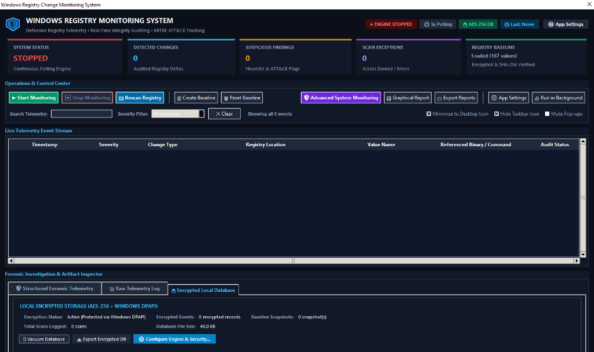
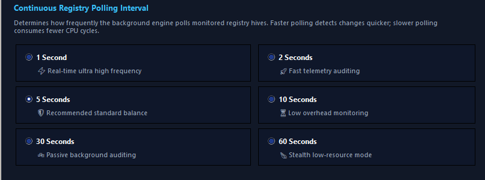

# 📖 Windows Registry Monitoring System — Operator & User Guide
### *Comprehensive Step-by-Step Manual for Defensive Telemetry, Baselining, and Configuration*
**Architect & Author:** Piyush | **Publisher:** MADE BY PIYUSH  
**Software Version:** 2.4.0 (Enterprise Edition)

---

## 📑 Table of Contents
1. [System Requirements & Pre-requisites](#1-system-requirements--pre-requisites)
2. [Installation & Deployment](#2-installation--deployment)
   - [Method A: Windows Installer Wizard (Recommended)](#method-a-windows-installer-wizard-recommended)
   - [Method B: Portable Standalone Executable](#method-b-portable-standalone-executable)
   - [Method C: Developer Source Execution](#method-c-developer-source-execution)
3. [Quick-Start: Your First 60 Seconds](#3-quick-start-your-first-60-seconds)
4. [Master Interface Walkthrough](#4-master-interface-walkthrough)
   - [Bento KPI Scorecards](#bento-kpi-scorecards)
   - [Operations Toolbar (Ribbon 1 & Ribbon 2)](#operations-toolbar-ribbon-1--ribbon-2)
   - [Search & Severity Filter Bar](#search--severity-filter-bar)
   - [Telemetry Event Table](#telemetry-event-table)
   - [Multi-Tab Forensic Inspector](#multi-tab-forensic-inspector)
5. [In-Depth Settings Guide (All 5 Tabs)](#5-in-depth-settings-guide-all-5-tabs)
   - [Tab 1: Engine & Polling Timing](#tab-1-engine--polling-timing)
   - [Tab 2: Appearance & Cyber Themes](#tab-2-appearance--cyber-themes)
   - [Tab 3: Windows Startup & Boot Mode](#tab-3-windows-startup--boot-mode)
   - [Tab 4: Encrypted Database & DPAPI](#tab-4-encrypted-database--dpapi)
   - [Tab 5: Alert Policies & Rate-Limiting](#tab-5-alert-policies--rate-limiting)
6. [Desktop Widget & Background Stealth Modes](#6-desktop-widget--background-stealth-modes)
7. [Visual Reporting & SIEM Data Export](#7-visual-reporting--siem-data-export)
8. [Troubleshooting & Diagnostics Guide](#8-troubleshooting--diagnostics-guide)
9. [Keyboard Shortcuts & Hotkeys](#9-keyboard-shortcuts--hotkeys)

---

## 1. System Requirements & Pre-requisites

| Component | Minimum Specification | Recommended Specification |
| :--- | :--- | :--- |
| **Operating System** | Windows 10 x64 (Build 1809+) | Windows 11 x64 (23H2+) or Windows Server 2022/2025 |
| **Processor** | Dual-core 1.5 GHz x86-64 | Quad-core 2.5 GHz+ (Intel Core i5 / AMD Ryzen 5 or better) |
| **Memory (RAM)** | 256 MB free RAM | 512 MB+ free RAM |
| **Disk Storage** | 150 MB free disk space | 1 GB+ (for long-term encrypted event history & logs) |
| **Hardware Security** | Not strictly required | Discrete TPM 2.0 (for hardware-tied DPAPI encryption) |
| **Privileges** | Standard User (monitors `HKCU`) | **Run as Administrator** (recommended to monitor `HKLM` security hives) |

> [!NOTE]
> Standard user accounts can run the application and monitor `HKEY_CURRENT_USER` startup keys without issue. However, monitoring sensitive system hives like `HKLM\SOFTWARE\Microsoft\Windows Defender` or `HKLM\SYSTEM\CurrentControlSet\Services` requires running the application with elevated administrator rights.

---

## 2. Installation & Deployment

### Method A: Windows Installer Wizard (Recommended)
1. Navigate to the `dist\installer\` folder or download `RegistryMonitorSetup.exe`.
2. Right-click `RegistryMonitorSetup.exe` and select **Run as administrator**.
3. Follow the Inno Setup Installation Wizard:
   - Accept the defensive software license.
   - Choose the installation directory (Default: `C:\Program Files\Windows Registry Monitor`).
   - Choose whether to create a Desktop Shortcut and Quick Launch icon.
   - Check the box **"Launch Windows Registry Monitor"** on the final screen and click **Finish**.
4. The installer registers clean uninstallation entries in **Windows Settings $\to$ Apps $\to$ Installed Apps**.

### Method B: Portable Standalone Executable
1. Locate `dist\WindowsRegistryMonitor.exe` (approximately 80.2 MB).
2. Copy this single `.exe` file to any portable USB drive, desktop folder, or DFIR triage toolkit directory.
3. Right-click and choose **Run as administrator**.
4. On first launch, the application automatically creates its own `data\` directory containing:
   - `data\baseline.json` (encrypted reference baseline)
   - `data\registry_monitor.db` (AES-256 local encrypted database)
   - `data\.security.dpapi` (DPAPI-protected master key)
   - `data\logs\` (audit logs)
   - `data\reports\` (exported reports)

### Method C: Developer Source Execution
If running from the source code repository:
```powershell
# Navigate to the workspace
cd "D:\Windows Registry Monitoring System"

# Ensure Python 3.12+ 64-bit is installed
python --version

# Run the application
python main.py
```

---

## 3. Quick-Start: Your First 60 Seconds

When launching the application for the very first time:

```
[ STEP 1 ] ──▶ Click "📋 Create Baseline" in Ribbon 1
               The scanner scans all monitored registry keys and builds
               a clean reference snapshot saved to data/baseline.json.

[ STEP 2 ] ──▶ Click "▶ Start Monitoring"
               The engine transitions to active state (GREEN).
               Background thread begins polling the registry every 5 seconds.

[ STEP 3 ] ──▶ Test Detection
               Open an administrative PowerShell prompt and add a test key:
               Set-ItemProperty -Path "HKCU:\Software\Microsoft\Windows\CurrentVersion\Run" `
                                -Name "TestAlert" -Value "C:\Windows\notepad.exe"

[ STEP 4 ] ──▶ Observe Instant Alert
               Within 5 seconds, an audible desktop notification pops up!
               The event appears in your telemetry table highlighted in AMBER.
```

---

## 4. Master Interface Walkthrough



*Figure 1: Full Master Operations Dashboard showing Header Badges, Bento KPI Scorecards, Operations Ribbons, Live Telemetry Stream, and Forensic Artifact Inspector.*

```
┌────────────────────────────────────────────────────────────────────────────────────────┐
│ 🛡️ WINDOWS REGISTRY MONITORING SYSTEM                                       [—] [口] [X]│
├────────────────────────────────────────────────────────────────────────────────────────┤
│ [● ENGINE STOPPED]  [⏱ 5s Polling]  [🔒 AES-256 DB]  [🕒 Last: Never]   [⚙️ App Settings]│
├────────────────────────────────────────────────────────────────────────────────────────┤
│ ┌──────────────┐ ┌──────────────┐ ┌──────────────┐ ┌──────────────┐ ┌────────────────┐ │
│ │SYSTEM STATUS │ │DETECTED      │ │SUSPICIOUS    │ │SCAN          │ │REGISTRY        │ │
│ │STOPPED       │ │0 CHANGES     │ │0 FINDINGS    │ │0 EXCEPTIONS  │ │167 VALUES      │ │
│ └──────────────┘ └──────────────┘ └──────────────┘ └──────────────┘ └────────────────┘ │
├────────────────────────────────────────────────────────────────────────────────────────┤
│ [▶ Start] [⏹ Stop] [🔄 Rescan] | [📋 Baseline] [🗑 Reset] | [🛡️ Remediate] [⚡ Clean All]│
│ [🛡️ Adv Monitoring] [📊 Graphical] [📁 Export] [⚙️ Settings] [👻 Run in Background]   │
├────────────────────────────────────────────────────────────────────────────────────────┤
│ Search: [                     ] Severity: [ All Severities ▼ ] [✕ Clear]   [Mute] [Hide]│
├────────────────────────────────────────────────────────────────────────────────────────┤
│ TIMESTAMP      SEVERITY      CHANGE TYPE   REGISTRY LOCATION      VALUE NAME   STATUS  │
│ 2026-10-22 ... SUSPICIOUS    ADDED         HKCU\...\Run           TrojanKey    DETECTED│
└────────────────────────────────────────────────────────────────────────────────────────┘
```

### Bento KPI Scorecards
- **Engine Status**: Displays current operational state (`STOPPED` in Red, `STARTING` in Amber, `MONITORING` in Green) alongside current polling cadence (`5s`).
- **Baseline Metadata**: Displays the count of tracked values and human-readable creation timestamp.
- **Total Changes**: Running counter of all state transitions captured during the session.
- **Suspicious / Investigation**: High-priority alert counter; immediately flags if malware or tampering is suspected.
- **Scan Errors**: Tracks access-denied or OS filesystem errors.

### Operations Toolbar (Ribbon 1 & Ribbon 2)
The split dual-ribbon interface separates continuous engine operations from one-off forensic actions:
- **`▶ Start Monitoring`**: Launches the background differential scanning thread.
- **`⏹ Stop Monitoring`**: Safely halts the monitoring thread without data loss.
- **`📋 Create Baseline`**: Prompts confirmation and executes an exhaustive fresh snapshot.
- **`🔄 Rescan Registry`**: Performs an immediate one-time differential scan without waiting for the next polling interval.
- **`🗑 Reset Baseline`**: Safely deletes the active baseline (creates a backup file `baseline.json.bak` first).
- **`📊 Visual HTML Report`**: Compiles an interactive Chart.js analytics report and opens it in your default browser.
- **`📁 Export CSV`**: Exports all captured events to an RFC-4180 compliant CSV file for SIEM ingestion.
- **`⚙️ Settings`**: Opens the comprehensive 5-tab configuration modal.
- **`🪟 Desktop Widget`**: Collapses the main window into a lightweight, draggable desktop HUD.
- **`👁 Hide to Tray`**: Conceals the application from the Windows taskbar.

---

## 5. In-Depth Settings Guide (All 5 Tabs)

Access the Settings Window by clicking **`⚙️ App Settings`** in Ribbon 2.

```
┌─────────────────────────────────────────────────────────────┐
│  ⚙️ Application Settings & Configuration             [X]    │
├─────────────────────────────────────────────────────────────┤
│  [Engine & Timing] [Themes] [Startup] [Database] [Alerts]   │
├─────────────────────────────────────────────────────────────┤
│  Engine Polling Interval (Seconds):                         │
│  [ 5          ]  (Valid range: 1 to 300 seconds)            │
│                                                             │
│  Registry Architecture Views:                               │
│  [X] Scan 64-bit Registry View (KEY_WOW64_64KEY)            │
│  [X] Scan 32-bit WOW64 Node (KEY_WOW64_32KEY)               │
│                                                             │
│  File Analysis & On-Disk Verification:                      │
│  [X] Resolve Executable Paths & Expand Environment Vars     │
│  [X] Compute SHA-256 Hashes of Referenced Binaries          │
│  [X] Verify File Existence and Stat Metadata                │
│                                                             │
│                                     [Save Settings] [Cancel]│
└─────────────────────────────────────────────────────────────┘
```

### Tab 1: Engine & Polling Timing



*Figure 2: Continuous Registry Polling Interval configuration with 6 selectable frequencies and dedicated Save button.*

The engine supports 6 dedicated polling speeds to suit any operational profile:
- **1 Second (⚡ Real-time ultra high frequency)**: Ideal for malware analysis sandboxes and active breach investigations where immediate detection is required.
- **2 Seconds (🚀 Fast telemetry auditing)**: Rapid threat hunting on high-performance analyst workstations.
- **5 Seconds (🛡️ Recommended standard balance)**: The optimal balance between instant alert velocity and near-zero CPU consumption.
- **10 Seconds (⏳ Low overhead monitoring)**: Minimal footprint monitoring for everyday office PCs.
- **30 Seconds (💤 Passive background auditing)**: Ultra-lightweight cadence for background auditing without battery drain on laptops.
- **60 Seconds (🍃 Stealth low-resource mode)**: Silent long-term surveillance mode for servers and virtual machines.

#### How to Save & Apply Timing:
1. Open **⚙️ App Settings** and stay on the **Engine & Timing** tab.
2. Click any of the 6 timing cards (or select its radio button).
3. Click the green **"💾 Save & Apply Timing Now"** button directly inside the tab.
4. The background monitoring thread immediately switches to the new polling speed without stopping or restarting!
5. **Quick Header Switch**: You can also click directly on the **`⏱️ 5s Polling`** badge in the top-right header of the main window to open a quick-switch popup menu!

---

## 6. Active Threat Remediation & Registry Deletion

When the monitoring engine flags an event with **Suspicious** or **Investigation Required** severity (such as an unauthorized startup trojan, ransomware disablement of Windows Defender, or an encoded PowerShell LOLBin), you can neutralize the threat directly from the application:

```
[ THREAT DETECTED ] ──▶ [ SELECT ROW ] ──▶ Click "🛡️ Remediate Threat"
                                                  │
                                                  ▼
                                       [ CONFIRMATION DIALOG ]
                                       Shows Hive, Subkey, Value & PE binary
                                                  │
                                                  ▼ [Confirm Delete]
                                       [ ATOMIC WIN32 REGISTRY DELETION ]
                                                  │
                                                  ▼
                                       • Status updated to "REMEDIATED" (Green)
                                       • Suspicious count decremented
                                       • Audit logged in AES-256 local database
```

### Method 1: Single-Threat Remediation
1. In the **Live Telemetry Event Stream** table, click on the row you wish to remediate.
2. Click **`🛡️ Remediate Threat`** in the Operations Toolbar (or right-click the row and select **"🛡️ Remediate & Delete Registry Entry"**).
3. Review the **Threat Remediation Warning Dialog**:
   - Inspects the Hive, Subkey path, Value Name, Command Data, and on-disk PE binary path.
4. Click **`🗑️ Confirm & Delete Registry Value`**.
5. The system invokes native Windows API `winreg.DeleteValue` with elevated privileges.
6. The entry in your telemetry table updates to **`REMEDIATED`** with an emerald green highlight, and your **SUSPICIOUS FINDINGS** counter decrements automatically!

### Method 2: Batch Auto-Clean All Threats
If multiple malicious keys were dropped during a malware attack:
1. Click **`⚡ Auto-Clean Threats`** in Ribbon 1.
2. The system scans all active un-remediated suspicious events and displays a confirmation summary of all targeted registry values.
3. Click **"Yes"** to execute batch deletion across all flagged registry keys.
4. All threats are neutralized simultaneously, and a complete remediation log is stored in your local encrypted SQLite database!

---

## 7. Desktop Widget & Background Stealth Modes
Select between five hand-crafted cyber themes:
- **Cyber Blue Team (Default)**: Optimized for all-day SOC monitoring.
- **Obsidian Stealth**: Ultra-dark OLED palette for low-light environments.
- **Matrix Terminal**: High-contrast phosphor green on black for terminal enthusiasts.
- **Crimson Alert**: High-urgency red palette ideal for incident response war-rooms.
- **Nordic Frost**: Cool arctic teal and ice-slate palette.
*Theme changes apply instantly across the entire interface without restarting the app!*

### Tab 3: Windows Startup & Boot Mode
- **Run at Windows Startup**: Check this box to register the app in `HKCU\Software\Microsoft\Windows\CurrentVersion\Run`.
- **Start Minimized to System Tray**: When checked, the application starts silently in the background on PC boot with `--minimized`, immediately monitoring without cluttering your screen.

### Tab 4: Encrypted Database & DPAPI
- **Live Database Telemetry**: Shows active database path, record count, and file size on disk.
- **DPAPI Protection Status**: Displays hardware encryption binding status (User SID + TPM 2.0).
- **🧹 Vacuum & Optimize**: Cleans SQLite free pages, re-indexes tables, and reduces file size.
- **📤 Export Plaintext JSON**: Allows authorized operators to export decrypted historical telemetry for offline legal or forensic preservation.

### Tab 5: Alert Policies & Rate-Limiting
- **Enable Desktop Pop-up Alerts**: Global switch for interactive messageboxes.
- **Severity Threshold**: Filter pop-up alerts by priority (`Informational`, `Suspicious`, or `Investigation Required`).
- **Rate-Limit Cooldown**: Enforces a minimum cooldown (e.g., 3 seconds) between popups to prevent notification storms.
- **Mute Pop-ups Checkbox**: Instantly mutes all visual popups while continuing to record all events in the background database.

---

## 6. Desktop Widget & Background Stealth Modes

### Draggable Desktop Widget Mode
Click **`🪟 Desktop Widget`** in Ribbon 2.
- The full 1200x800 dashboard collapses into a compact 220x110 HUD tile.
- Features:
  - Shows live engine state (`MONITORING` with pulsing green indicator).
  - Shows current change and suspicious counters in real-time.
  - **Always on top**: Floats above all open windows.
  - **Draggable**: Click and drag anywhere on the widget to reposition it on any monitor.
  - **Double-click to restore**: Double-clicking the widget immediately restores the full master dashboard.

### Concealing from Windows Taskbar
Click **`👁 Hide to Tray / Background`** in Ribbon 2.
- Removes the application icon from the Windows taskbar using Win32 window style masking.
- Continues continuous background polling and encrypted logging.
- Click the floating widget or use the shortcut key to bring the dashboard back.

---

## 7. Visual Reporting & SIEM Data Export

### Interactive HTML Visual Report
1. Click **`📊 Visual HTML Report`** in Ribbon 2.
2. The report generator automatically processes all recorded events and produces a self-contained HTML file in `data/reports/visual_report_<timestamp>.html`.
3. The report is opened directly in your default web browser (Edge, Chrome, Firefox).
4. Includes:
   - Chart.js interactive Donut Chart of severity distribution.
   - Change type breakdown bar chart.
   - Searchable, sortable HTML data table with color-coded badges.

### CSV Export for SIEM Integration
1. Click **`📁 Export CSV`** in Ribbon 2.
2. An RFC-4180 compliant CSV file is written to `data/reports/events_<timestamp>.csv`.
3. Standard columns include:
   - `event_id`, `timestamp`, `change_type`, `severity`, `full_path`, `value_name`, `previous_value`, `current_value`, `resolved_file_path`, `file_exists`, `sha256`.
4. Directly importable into Microsoft Excel, Splunk, Elastic, or Google Chronicle.

---

## 8. Troubleshooting & Diagnostics Guide

### Issue: "Access Denied" on Certain Keys
- **Cause**: Windows protects certain registry hives (such as `HKLM\SYSTEM\CurrentControlSet\Services` and Defender real-time protection) from standard user accounts.
- **Solution**: Close the application, right-click `WindowsRegistryMonitor.exe`, and select **Run as administrator**.

### Issue: The Database Cannot Be Decrypted on Another Computer
- **Cause**: This is a core security feature! The master key is encrypted with Windows DPAPI, binding it to the original machine's hardware and user profile.
- **Solution**: To migrate data, click **Settings $\to$ Database $\to$ Export Plaintext JSON** on the source computer *before* moving files.

### Issue: Windows SmartScreen or Antivirus Flags the Executable
- **Cause**: PyInstaller standalone executables are sometimes flagged as generic false positives by heuristic cloud scanners due to runtime binary unpacking.
- **Solution**: Add an exclusion for `WindowsRegistryMonitor.exe` in Windows Defender, or build directly from source using Python 3.12.

---

## 9. Keyboard Shortcuts & Hotkeys

| Shortcut | Action |
| :--- | :--- |
| `Ctrl + S` | Start Monitoring Engine |
| `Ctrl + Q` | Stop Monitoring Engine |
| `Ctrl + B` | Trigger Create Baseline Wizard |
| `Ctrl + R` | Trigger One-Time Rescan |
| `Ctrl + E` | Open Export CSV Dialog |
| `Ctrl + P` | Generate Visual HTML Report |
| `Ctrl + ,` | Open App Settings Modal |
| `Ctrl + W` | Toggle Desktop Floating Widget |
| `Escape` | Close active dialog or dismiss modal |

---

*Windows Registry Monitoring System — Operator & User Manual*  
*Created & Engineered by **Piyush** | **MADE BY PIYUSH***  
*Document Version: 2.4.0 (Enterprise Edition)*
